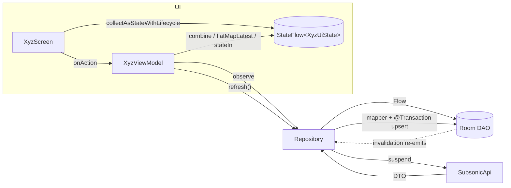
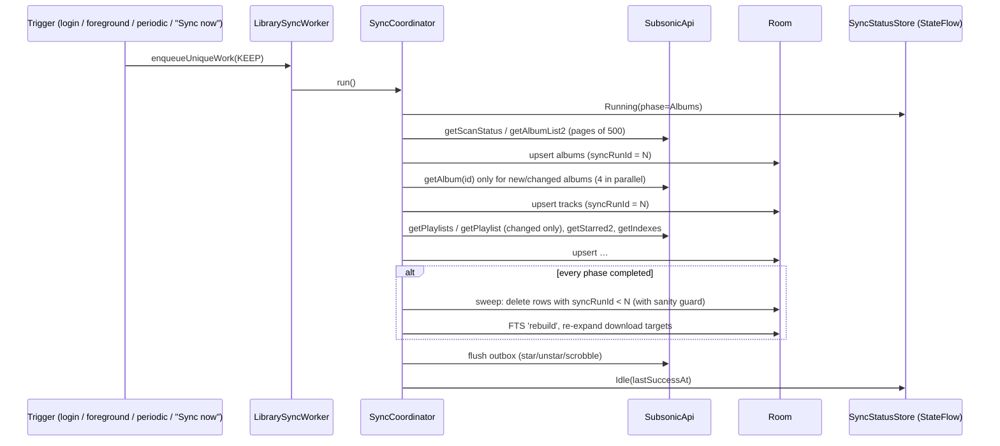

# Offbeat — Architecture Plan

> Self-hosted, offline-first Android music player for OpenSubsonic servers (tested against Navidrome).
> Package: `dev.yourname.offbeat` · Single Gradle module · Kotlin + Compose + Material 3
> Written 2026-10-04. This is a planning document: it contains no production code, only sketches to explain the design.

## Contents

0. [Read this first](#0-read-this-first)
1. [Architecture overview](#1-architecture-overview)
2. [Folder and file structure](#2-folder-and-file-structure)
3. [Media3 design](#3-media3-design)
4. [Room schema](#4-room-schema)
5. [Navigation 3 setup](#5-navigation-3-setup)
6. [Hilt DI](#6-hilt-di)
7. [Server auth and API](#7-server-auth-and-api)
8. [Theming, platform requirements, build and tests](#8-theming-platform-requirements-build-and-tests)
9. [Hour estimates, priority order and calendar](#9-hour-estimates-priority-order-and-calendar)
10. [Gotchas and things to verify](#10-gotchas-and-things-to-verify)

---

## 0. Read this first

### 0.1 Your prompt was cut off

The request stopped partway through item 7 ("…search3, stream, download, getCoverArt,"). I filled in the rest as follows:

- **Section 7** finishes the endpoint list. It also covers the error model, credential storage and cleartext handling.
- **Section 8** is my guess at your missing item 8. It holds everything else from your Constraints: the theming plan, permissions, real-device and OEM issues, build files and testing.
- **Section 9** is the hour estimates and priority order you referred to as "item 9".

If item 8 meant something else, tell me and I'll add it.

### 0.2 What I found in the existing project

You already have an Android Studio template project. It affects several decisions:

| Found | Consequence |
|---|---|
| AGP **9.4.1**, Gradle 9.6, Kotlin 2.2.10 | AGP 9 has **built-in Kotlin**, so you don't apply `org.jetbrains.kotlin.android`. You add only `kotlin.plugin.compose`, `kotlin.plugin.serialization`, `ksp`, `hilt` and `androidx.room`. Use **KSP2**. The Hilt Gradle plugin must be a release that supports AGP 9 (see §10). |
| `compileSdk`/`targetSdk` = **37** (Android 17) | Targeting 37 most likely means Android's **local network access permission** applies to your app. A Navidrome server on your home LAN is exactly that case. See §8.4. |
| `minSdk = 27` | **Keep it.** It gives `java.time` without desugaring, notification channels, adaptive icons and roughly 98% of devices. Media3, Room and Compose all support it. Going lower gains nothing. Going higher (e.g. 30 for SQLite window functions) isn't worth losing users. |
| `lifecycle 2.6.1`, `activity-compose 1.8.0` | These are stale template versions. Nav3's ViewModel decorator needs a much newer lifecycle (2.10.x or later). Bump everything (§8.6). |
| Template `Theme.kt` uses dynamic color | Delete that branch, since dynamic color is out of scope. |
| `namespace`/`applicationId` = `com.example.offbeat` | Change both to `dev.yourname.offbeat` and move the sources. Do this **before** anything else. |
| R8 rules in `src/main/keepRules/rules.keep` | That's the AGP 9 location. The doc uses it instead of `proguard-rules.pro`. |
| No git repo | Run `git init` and commit the template before you start. The Room schema JSONs (§4.9) need version control. |

### 0.3 Verdicts on your tech choices

You asked me to challenge your choices. Where I disagree, I say so: 

| Your choice | Verdict | Why |
|---|---|---|
| Kotlin, Compose, M3, MVVM + UDF, StateFlow, `collectAsStateWithLifecycle` | **Keep** | This is the standard stack, and nothing about this app fights it. |
| Retrofit **or** Ktor | **Retrofit + OkHttp** | Media3 has `OkHttpDataSource` and Coil 3 has an OkHttp network fetcher. One `OkHttpClient` (one connection pool, one TLS/cleartext policy, one interceptor chain) then serves the API, audio streaming and cover art. Ktor would add a second HTTP stack for no gain. |
| Domain layer | **No** | At this size, use-case classes like `GetAlbumUseCase` would just forward calls to a repository. You'd write ~40 files that do nothing. Instead, keep a **pure-Kotlin `core/model`** package (so UI never sees Room entities or DTOs) and put real logic in ~5 small pure classes (`StatsCalculator`, `StreakCalculator`, `SearchRanker`, `FolderTrackResolver`, `LrcParser`). Those are your "domain", and they're easy to unit-test. |
| Room as the single source of truth; UI reads only from the DB | **Keep, with 4 explicit exceptions** | (1) **Live playback state** (playing, position, current queue) comes from the player through `MediaController`, because the player *is* the truth. Copying it to Room 4×/second would be absurd. (2) **Server status and latency** are live measurements, so they're kept in memory only. (3) **Setup checks** are live. (4) **Sleep timer and EQ capabilities** are service-side state shared through an in-memory StateFlow. Everything about the *library* and *user data* goes through Room. |
| Paging 3 "where justified" | **Not justified, so skip it** | None of your screens is an unbounded list that would justify it. Library has Playlists, Folders and Server tabs, with no "All songs" list. A playlist of 3,000 tracks loaded as `Flow<List<Track>>` into a `LazyColumn` is fine, because Room loads 3,000 small rows in a few ms and LazyColumn only composes visible rows. Paging adds `PagingSource`, `LazyPagingItems`, placeholders and awkward Flow combination. Add it only if you later build an "All songs" screen. Sync uses plain manual paging loops (`offset += 500`), not Paging 3. |
| FTS | **Yes, FTS4** | Offline search over thousands of tracks with prefix matching is exactly what FTS is for. Room only has `@Fts3`/`@Fts4` annotations, with no FTS5. See §4.6 for the two traps (`REPLACE` and `VACUUM`). |
| Navigation 3 with one back stack per tab | **Keep, but know it's DIY** | Nav3 1.x gives you the pieces (`NavBackStack`, `NavDisplay`, entry decorators) but no ready-made bottom-nav component. You'll assemble a ~120-line `NavigationState` + `Navigator` following the official nav3-recipes "multiple back stacks" pattern. I'm also **not** making Now Playing/Lyrics/Queue into routes (§5.6). |
| Media3 ExoPlayer + MediaSessionService + MediaController | **Keep** | It's the only sane choice for background playback with lock-screen and Bluetooth controls. |
| Media3 download support **and** WorkManager for queued downloads | **Keep both, with roles separated** | Media3's `DownloadManager` *is* your download queue. `Requirements(NETWORK_UNMETERED)` gives you "waits for Wi-Fi", and `WorkManagerScheduler` (from `media3-exoplayer-workmanager`) wakes the download service when Wi-Fi returns. Don't write your own download worker on top. WorkManager handles **library sync** and the **outbox** (likes and scrobbles). |
| DataStore for settings **and credentials** | **Settings yes; credentials not as plain text** | DataStore files are plain protobuf on disk. Store **username + a salt + the token, never the password** (§7.2), and encrypt them with an Android Keystore AES-GCM key. `EncryptedSharedPreferences` is deprecated, so don't use it. |
| Hilt with KSP, minimal setup | **Keep, with one non-negotiable** | The **ExoPlayer must be `@ServiceScoped`** (in Hilt's `ServiceComponent`), not `@Singleton`. That's the #1 mistake (§6.5). I also avoid qualifiers by using small wrapper types (`AppCoroutineScope`). Repositories are concrete `@Inject` classes, and only `PlaybackRepository` gets an interface (so you can fake it in ViewModel tests). |
| Charts drawn with Canvas | **Keep** | You need one chart type (vertical bars, at most 24 of them). A reusable `BarChart` is about 150 lines, matches the Classical look exactly, and adds no dependency. |
| Single module, packages ready to split | **Keep** | The package layout in §2 maps 1:1 to the Now-in-Android module layout. |
| Version catalog | **Keep** | It's already set up. |
| *(not mentioned)* drag-to-reorder | **Use a library**: `sh.calvin.reorderable` | Hand-written drag-reorder in a `LazyColumn` (auto-scroll, item offsets, haptics) takes 3–4 hours and has a long tail of bugs. Using a library here is the right call. |
| *(not mentioned)* Material icons | **Don't depend on `material-icons-extended`** | It's huge, and all of its icons are compiled into debug builds. Import the ~30 icons you need from Material Symbols as vector drawables. |

### 0.4 Design assumptions I reconciled

| # | Design said | Reality | Decision |
|---|---|---|---|
| a | "Access key" | The Subsonic API authenticates with **username + password**, sent as `t = md5(password + salt)` and `s = salt`. OpenSubsonic later added an **optional** `apiKeyAuthentication` extension, which not every server supports. | Setup asks for **URL, username and password**. If `getOpenSubsonicExtensions` lists `apiKeyAuthentication`, an "Use API key instead" toggle appears (`AuthStrategy.ApiKey`). The help sheet becomes **"Where do I find my credentials?"**: they're your Navidrome login, the default port is 4533, and here's how to find your server's LAN IP. |
| b | Listening history is stored on the server | Subsonic servers keep only play counts and "now playing", not a timestamped history you could build hour, week or streak stats from. | **Local `play_events` table in Room** is the source of truth for Stats. Scrobbling to the server is an **optional** setting (on by default) and goes through the outbox. Consequence: **history only starts when Offbeat is installed, and it's lost on reinstall** unless you back it up. See §8.5 for Auto Backup rules and an optional "export history" item. |
| c | "My folders" vs "Server" folders | These are two unrelated concepts. | **Completely separate tables and code paths.** My folders: `my_folders` + `my_folder_items` (local, nestable, never synced). Server folders: `server_dirs` (a cache of `getIndexes`/`getMusicDirectory`). The only bridge: a my-folder can *contain a reference* to a server directory (`my_folder_items.itemType = SERVER_DIR`). |
| d | Server status shows **server disk usage** | No Subsonic/OpenSubsonic endpoint exposes disk usage. Navidrome's own `/api` does, but using it would tie you to Navidrome. | Show **library size** (sum of `tracks.size`), track/album/artist counts, scan status, last scan time, server version and latency. Label the size "Library size", not "Disk". |
| e | "Like" on a **playlist** detail | Subsonic can star songs, albums and artists, but **not playlists**. | On playlists, the heart becomes **"Pin to Home"** (local `pins` table), with a pin icon so it's honest. Albums and songs use real `star`/`unstar`. |
| f | Synced **.lrc** lyrics | OpenSubsonic `getLyricsBySongId` (extension `songLyrics`) returns **structured** lyrics (`line[] { start ms, value }`). Navidrome already parses embedded or sidecar LRC for you. | Use structured lyrics. Keep a tiny `LrcParser` only for the legacy `getLyrics` fallback when its text contains `[mm:ss.xx]` timestamps. It's cut-first if time runs short. |
| g | Search has an **Artists** filter, but no artist screen exists | Tapping an artist result would lead nowhere. | Add an **`ArtistDetail`** route (artist header plus an album grid that reuses `AlbumCard`). It takes about 2h. |
| h | Search lists **server folders** | Search is local (FTS), and only the parts of the folder tree we've fetched are in Room. | Sync caches the **top two levels** (music folders plus `getIndexes`). Deeper folders are cached when you browse them. Folder search only covers what's cached, and the UI says "Folders you've browsed". |
| i | Home chips All / Music / Folders / Downloaded | Their meaning wasn't defined. | **All** shows everything. **Music** shows server collections (albums, playlists, liked). **Folders** shows my folders and pinned server dirs. **Downloaded** shows only collections that are fully downloaded. The chips filter both the quick-access grid and "Jump back in". |
| j | Playlist editing | It's not in your feature list. | Server playlists are **read-only** in Offbeat. Adding create/rename/add-tracks later costs ~3h (`createPlaylist`/`updatePlaylist` plus outbox ops). |

---

## 1. Architecture overview

### 1.1 Layers

```
┌────────────────────────────────────────────────────────────────────────┐
│ UI layer      Composable screens  ←StateFlow<UiState>─  ViewModels     │
│               (feature/*)         ─onAction(Action)→   (@HiltViewModel)│
├────────────────────────────────────────────────────────────────────────┤
│ Data layer    Repositories (core/data)  – the ONLY thing VMs talk to    │
│               + pure logic helpers (StatsCalculator, SearchRanker …)    │
├──────────────┬──────────────┬──────────────┬───────────────────────────┤
│ Room (DAOs)  │ Retrofit API │ DataStore    │ Media layer (core/media)   │
│ core/database│ core/network │ core/datastore│ MediaController ↔ Service │
└──────────────┴──────────────┴──────────────┴───────────────────────────┘
        ▲ background writers: WorkManager workers (core/work),
          PlaybackService listeners (play events, queue persistence),
          DownloadManager listener (download state mirror)
```

**Rules that keep the app predictable:**

1. A ViewModel injects **repositories only**: never a DAO, the API, DataStore or the MediaController directly. Repositories are where "read Room, refresh from the network" lives, so ViewModels stay tiny.
2. Repository **reads** return `Flow<…>` from Room. Repository **refreshes** are `suspend fun refreshX(): Result<Unit>`. They call the API, map DTOs to entities and write to Room in one transaction. The Flow then re-emits on its own. **The network never returns data to the UI directly.**
3. **Models cross layers, entities and DTOs don't.** The rule for mapping:
   - DTO → Entity happens in `core/data/mapper/DtoMappers.kt`.
   - Entity → Model happens in `core/data/mapper/EntityMappers.kt`.
   - The UI only sees `core/model`.
   - When a screen needs a joined shape (e.g. track + download state), the DAO returns a Room projection class, which gets mapped to a model.
4. Anything that needs the **`Player` instance lives inside the service**. The UI reaches it in three ways: standard `MediaController` calls, custom `SessionCommand`s, or shared settings in DataStore that the service observes.

### 1.2 Do you need a domain layer? No.

The real reason to have a domain layer is to share business logic between several features or modules, or to keep the data layer swappable. Here:

- Most logic is "observe a query" (ViewModel → repository → DAO), and use cases would add a pass-through hop.
- The genuinely interesting logic is a handful of algorithms: stats bucketing and comparison, streaks, search ranking, folder flattening, LRC parsing, and when a play counts as a play. Put each in a **plain Kotlin class with no Android imports** (in `core/data/logic` or `core/model`) and unit-test it.

If one repository function ever needs data from three other repositories, *that's* when you create a single use case for it. Don't do it preemptively.

### 1.3 Data flow diagrams

**Read path (every screen):**



**Sync path (background):**



**Playback path:** see §3.1.

### 1.4 How offline-first works

**What reads from where:**

| Data | UI reads from | Written by |
|---|---|---|
| Albums, tracks, artists, playlists, starred | Room | Sync (`SyncCoordinator`), on-demand refresh in detail screens, optimistic like toggles |
| Server folder tree | Room `server_dirs` + `tracks.parentDirId` | `ServerFolderRepository.refreshDir(id)` when a folder is opened (stale-while-revalidate), and sync for the top levels |
| My folders, pins | Room | User actions only (never synced) |
| Download state and progress | Room `downloads` | `DownloadStateMirror` (a `DownloadManager.Listener` in the media layer) |
| Stats, history | Room `play_events` | `PlayEventRecorder` in the service |
| Lyrics | Room `lyrics` (a cache) | `LyricsRepository` fetches when the track is first shown |
| Settings, credentials | DataStore | Settings/setup screens |
| Now playing, queue, position | **MediaController** (live) | The player. Persisted to Room by `QueuePersister` only for restore. |
| Server status | In-memory (polled live while visible) | `ServerRepository` |

**When sync happens:**

| Trigger | Mechanism | Notes |
|---|---|---|
| First successful login | One-time `LibrarySyncWorker` (plain, not expedited — §6.4) | Setup shows progress from `SyncStatusStore` |
| App comes to foreground and the last sync was >6h ago | `AppViewModel` → `SyncScheduler.syncIfStale()` | Cheap first step: `getScanStatus.lastScan` unchanged means skip the heavy phases |
| Periodic | `PeriodicWorkRequest` every 12h, constraints: network connected, battery not low | OEMs may delay this (§8.4). That's acceptable. |
| "Sync now" (Offline tab) | One-time work, `ExistingWorkPolicy.KEEP` | KEEP means double-tapping doesn't start two syncs |
| Opening an album, playlist or folder | Repository `refreshX(id)` from the ViewModel's `init` | Shows cached data instantly, then updates in place |
| Like / unlike, scrobble | Write to the outbox → one-time `OutboxWorker` (network constraint) | Works offline and flushes later |

**Ownership and conflicts.** Each table has exactly one owner:

| Data | Owner | Conflict rule |
|---|---|---|
| Library metadata (tracks, albums, artists, playlists, server dirs) | **Server** | Server always wins. Sync overwrites. |
| Starred / liked | Server, with **local optimistic writes** | Liking writes `starredAt` to Room immediately and enqueues an outbox op. While an op for that id is pending, **sync must not overwrite that row's `starredAt`**. The upsert skips ids that are in the outbox. After the flush, the server value wins (last write wins). |
| My folders, pins, download targets, play events, queue | **Local** | Never sent to the server and never overwritten by sync. |
| Scrobbles | Local → server (one-way) | The outbox retries with backoff. Errors 40/41 stop retrying, and code 70 (not found) drops the op. |

**Deletions (mark-and-sweep):**

1. Each sync run gets an id `N` (a timestamp). Every upserted row is stamped with `syncRunId = N`.
2. **Only if every listing phase completed without error**, delete rows where `syncRunId < N` from `albums`, `tracks`, `artists` and `playlists`.
3. **Sanity guard:** if the new run saw less than 50% of the previous album count, skip the sweep and log it. A server mid-rescan or a misconfigured music folder must not wipe your library.
4. Deleted tracks that were downloaded: their `download_target_tracks` rows disappear when targets are re-expanded, and the garbage-collection step then removes them from the Media3 cache (§3.9).
5. `play_events` are **never** deleted by sync. Stats keep working for tracks that no longer exist. Rows show "Unknown track" if the join fails, which is why `play_events.trackId` has no foreign key.
6. A playlist's track list is replaced wholesale whenever its `changed` timestamp differs: delete its `playlist_tracks`, then insert, in one transaction.

**No network.** `ConnectivityMonitor` exposes `Flow<NetworkState>`. When offline:

- Tracks without a completed download are greyed out (a `TrackRow` with `isAvailable = false`).
- Play actions skip unavailable tracks.
- A slim "Offline: showing downloaded music" banner appears.
- Refresh calls fail fast and silently, since the cached UI is already showing.

### 1.5 The ViewModel pattern (UDF) you'll repeat 15 times

```kotlin
data class HomeUiState(
    val isLoading: Boolean = true,
    val filter: HomeFilter = HomeFilter.All,
    val greeting: Greeting = Greeting.Evening,
    val quickAccess: List<QuickAccessItem> = emptyList(),
    val jumpBackIn: List<CollectionCard> = emptyList(),
)

sealed interface HomeAction {
    data class SelectFilter(val filter: HomeFilter) : HomeAction
    data class Play(val ref: CollectionRef) : HomeAction
}

@HiltViewModel
class HomeViewModel @Inject constructor(
    private val library: LibraryRepository,
    private val playback: PlaybackRepository,
) : ViewModel() {

    private val filter = MutableStateFlow(HomeFilter.All)

    val uiState: StateFlow<HomeUiState> = filter
        .flatMapLatest { f ->                       // switch queries when the chip changes
            combine(library.quickAccess(f), library.jumpBackIn(f)) { quick, recent ->
                HomeUiState(isLoading = false, filter = f, greeting = Greeting.now(),
                            quickAccess = quick, jumpBackIn = recent)
            }
        }
        .stateIn(viewModelScope, SharingStarted.WhileSubscribed(5_000), HomeUiState())

    fun onAction(action: HomeAction) = when (action) {
        is HomeAction.SelectFilter -> filter.value = action.filter
        is HomeAction.Play -> viewModelScope.launch { playback.playCollection(action.ref) }
    }
}
```

Each screen has a stateful wrapper and a stateless content composable:

```kotlin
@Composable
fun HomeScreen(viewModel: HomeViewModel, onOpen: (NavKey) -> Unit) {
    val state by viewModel.uiState.collectAsStateWithLifecycle()
    HomeContent(state, onAction = viewModel::onAction, onOpen = onOpen)   // stateless, previewable
}
```

Why `WhileSubscribed(5_000)`: on rotation the UI unsubscribes for less than a second, so the upstream query keeps running. If you leave the screen for longer than 5s, the Room query stops.

### 1.6 Flow operators and where you'll use each

| Operator | Where in Offbeat | What it teaches |
|---|---|---|
| `stateIn(scope, WhileSubscribed(5000), initial)` | Every ViewModel's `uiState` | Turns a cold Room flow into hot UI state |
| `combine(a, b, …)` | Home (quick access + recents), Detail (album + tracks + download state + current track id), Offline | Several sources become one state |
| `flatMapLatest` | Home filter chips, NowPlaying (`currentTrackId → trackRepo.observe(id)`), Stats (period tab → queries), ServerBrowser (dirId → children) | Cancels the old query when the input changes |
| `debounce(250)` + `distinctUntilChanged()` | Search query | Avoids running FTS on every keystroke |
| `map { }.distinctUntilChanged()` | Lyrics (`position → currentLineIndex`) | Recompose only when the line changes, not 5 times a second |
| `callbackFlow { … awaitClose { } }` | `PlaybackRepositoryImpl` (Player.Listener → Flow), `ConnectivityMonitor` (NetworkCallback → Flow) | Wraps callback APIs |
| `shareIn` / `stateIn` in a singleton | `PlaybackRepository.state`, `ServerConfigStore.config` | One upstream for many collectors |
| `conflate()` | Download progress mirror | Drops stale progress updates |
| `onStart { emit(…) }` / `catch { }` | Repository flows that also trigger refresh | Error handling without crashing the collector |
| `flow { while (true) { emit(); delay() } }` | Position ticker, server-status polling | Polling that stops when nobody collects |

---

## 2. Folder and file structure

### 2.1 Feature-based or layer-based? Feature-based UI on a shared core.

- **`feature/*`** holds screens, ViewModels and UI state, one package per feature. When you work on "Stats", every file is in one folder. Features **never import each other** except through navigation keys (`app/navigation/Routes.kt`). The one exception: shared sheets like "Add to folder" live in the feature that owns them and are opened through a callback.
- **`core/*`** holds the things every feature shares (database, network, data, media, design system). These are layer-based **because they're shared**. A per-feature data layer would duplicate the `tracks` table logic four times.
- **`app/`** holds the shell: the root composable, scaffold and navigation wiring.

This is exactly the Now-in-Android module graph flattened into packages. Splitting into modules later means moving each `core/x` and `feature/y` folder into a module, and the DI modules move with them because they sit next to what they provide.

Dependency direction (keep it acyclic): `app → feature/* → core/media → core/work → core/data → core/database, core/network, core/datastore → core/model, core/common`; `core/designsystem` is used by `app` and `feature/*` only.

### 2.2 Root and build files

```
Offbeat/
├── settings.gradle.kts            # Repositories, foojay toolchain, includes :app
├── build.gradle.kts               # Root: declares plugins with `apply false` (android, compose, serialization, ksp, hilt, room)
├── gradle.properties              # JVM args, configuration cache, Kotlin code style
├── gradle/
│   ├── libs.versions.toml         # Version catalog: every dependency and plugin version (see §8.6)
│   └── wrapper/…                  # Gradle 9.6 wrapper (generated, don't edit)
├── .gitignore                     # Ignores build/, local.properties, .idea/ caches
├── docs/
│   └── ARCHITECTURE.md            # This document
└── app/
    ├── build.gradle.kts           # Android config, KSP args, Room schema dir, dependencies
    ├── schemas/                   # Room exported schema JSONs per version — COMMIT these
    │   └── dev.yourname.offbeat.core.database.OffbeatDatabase/
    │       └── 1.json             # Schema v1, used by auto-migrations and MigrationTestHelper
    └── src/
        ├── main/
        │   ├── AndroidManifest.xml  # Permissions, Application, activity, 2 services, WorkManager initializer removal (§8.3)
        │   ├── keepRules/rules.keep # R8 rules (kotlinx.serialization DTOs, Retrofit) — AGP 9 location
        │   ├── java/dev/yourname/offbeat/…   # §2.3
        │   └── res/…                          # §2.4
        ├── test/java/dev/yourname/offbeat/…         # JVM unit tests (§2.5)
        └── androidTest/java/dev/yourname/offbeat/…  # Instrumented tests (§2.5)
```

### 2.3 Source tree: `app/src/main/java/dev/yourname/offbeat/`

```
dev/yourname/offbeat/
├── OffbeatApp.kt                    # @HiltAndroidApp; Configuration.Provider (HiltWorkerFactory); starts DownloadStateMirror + periodic sync
├── MainActivity.kt                  # @AndroidEntryPoint single activity; enableEdgeToEdge; setContent { OffbeatTheme { AppRoot() } }
│
├── app/                             # ── App shell (becomes the :app module) ──
│   ├── AppRoot.kt                   # Shows SetupFlow or MainScaffold depending on whether a server is configured
│   ├── AppViewModel.kt              # Exposes "configured?" + theme mode; on start: sync-if-stale, notification permission prompt state
│   ├── MainScaffold.kt              # Scaffold: NavDisplay content + bottomBar (MiniPlayer above NavigationBar) + PlayerOverlay on top
│   ├── OfflineBanner.kt             # Slim banner shown when ConnectivityMonitor reports no network
│   └── navigation/
│       ├── Routes.kt                # Every @Serializable NavKey (tab roots + detail routes) in one sealed hierarchy
│       ├── TopLevelDestination.kt   # Enum of the 5 tabs: root key, label res, selected/unselected icon
│       ├── NavigationState.kt       # Holds one NavBackStack per tab + current tab; rememberNavigationState()
│       ├── Navigator.kt             # navigate(key), goBack(), selectTab(tab), popToAncestor(key) rules
│       └── OffbeatEntryProvider.kt  # entryProvider { entry<Key> { … } } mapping every key to its screen + ViewModel creation
│
├── core/
│   ├── model/                       # ── Pure Kotlin models: no Android, Room or Retrofit imports ──
│   │   ├── Track.kt                 # Track model incl. AudioQuality, availability flag, starred
│   │   ├── Album.kt                 # Album model (artist, year, cover, counts, starred, downloadState)
│   │   ├── Artist.kt                # Artist model
│   │   ├── Playlist.kt              # Server playlist model (read-only)
│   │   ├── ServerDir.kt             # Server folder + ServerDirChild (Dir | Track) for the browser
│   │   ├── MyFolder.kt              # Local virtual folder + MyFolderItem (Playlist | Album | ServerDir)
│   │   ├── CollectionRef.kt         # Sealed reference to anything playable/downloadable/pinnable: Album/Playlist/MyFolder/ServerDir/Liked/Track
│   │   ├── AudioQuality.kt          # codec (suffix), bitDepth, sampleRate, bitRate, isLossless + badge label formatter
│   │   ├── DownloadInfo.kt          # DownloadState enum + per-collection progress (done/total/bytes)
│   │   ├── PlaybackState.kt         # Snapshot the UI renders: current item, isPlaying, buffering, shuffle, repeat, duration, error
│   │   ├── QueueItem.kt             # Queue row: index, trackId, title, artist, artwork
│   │   ├── Lyrics.kt                # Lyrics (synced flag, offset) + LyricLine(startMs, text)
│   │   ├── Stats.kt                 # StatsPeriod (Day/Week/Year), StatsBucket, StatsSummary, Comparison, Busiest, StreakInfo
│   │   ├── SearchResults.kt         # TopResult + songs/albums/artists/folders lists + SearchFilter enum
│   │   ├── ServerConfig.kt          # baseUrl, username, AuthStrategy (Token(salt, token) | ApiKey(key)), isCleartext
│   │   ├── ServerStatus.kt          # reachable, latencyMs, apiVersion, serverType/version, counts, scan state, librarySize
│   │   ├── SyncState.kt             # Idle(lastSuccessAt) | Running(phase, done, total) | Failed(error, at)
│   │   ├── SleepTimerState.kt       # Off | Countdown(endsAtElapsed) | EndOfTrack
│   │   ├── EqualizerModels.kt       # EqSettings (enabled, presetId, bandLevels) + EqCapabilities (bands, freqs, range)
│   │   └── AppSettings.kt           # ThemeMode, wifiOnlyDownloads, storageCapBytes, scrobbleEnabled, keepPlayingFromFolder
│   │
│   ├── common/                      # ── Tiny shared utilities ──
│   │   ├── AppCoroutineScope.kt     # @Singleton app-lifetime CoroutineScope (SupervisorJob + Default); avoids a qualifier
│   │   ├── AppError.kt              # Sealed error type (Network, Unauthorized, NotFound, Server(code,msg), Unknown) + toMessageRes()
│   │   ├── TimeProvider.kt          # Injectable clock (now, zone, elapsedRealtime) so stats/streak/recorder are testable
│   │   ├── Formatters.kt            # Duration (3:42, 12 h 5 min), bytes (1.2 GB), relative time, sample-rate/bit-depth labels
│   │   └── Chunked.kt               # chunkedIn(500) helper for Room IN-queries (SQLite 999-variable limit on API ≤ 30)
│   │
│   ├── designsystem/                # ── Theme + reusable UI (becomes :core:designsystem) ──
│   │   ├── theme/
│   │   │   ├── Color.kt             # Raw palette (cream, ink, gold, bronze, player blacks) — no semantics
│   │   │   ├── ColorScheme.kt       # lightColorScheme/darkColorScheme mapping palette → M3 roles; PlayerColorScheme
│   │   │   ├── ExtendedColors.kt    # Non-M3 tokens (hairline, goldAccent, chartBar, chartBarMuted, warning) via CompositionLocal
│   │   │   ├── Type.kt              # Cormorant (display/headline/titleLarge) + sans body/label Typography
│   │   │   ├── Shape.kt             # Classical small-radius Shapes
│   │   │   ├── Spacing.kt           # 4/8/12/16/24/32 dp spacing tokens
│   │   │   └── Theme.kt             # OffbeatTheme(themeMode) + PlayerTheme { } (always very dark)
│   │   ├── icon/
│   │   │   └── OffbeatIcons.kt      # Object mapping names → painterResource(R.drawable.ic_*) for the ~30 icons
│   │   └── component/
│   │       ├── CoverArt.kt          # Coil AsyncImage with CoverArtModel(id,size), placeholder, square/round variants
│   │       ├── TrackRow.kt          # Song row: number/art, title, artist, duration, now-playing indicator, download dot, disabled state
│   │       ├── CollectionCard.kt    # Album/playlist/folder card used in grids and carousels
│   │       ├── QuickAccessTile.kt   # Compact horizontal tile for Home's quick-access grid
│   │       ├── FilterChipRow.kt     # Horizontally scrolling single-select FilterChips bound to an enum
│   │       ├── SectionHeader.kt     # Serif section title + optional "See all" action
│   │       ├── GoldDivider.kt       # 1dp hairline divider in the extended `hairline` color
│   │       ├── LikeButton.kt        # Animated heart toggle (or pin variant for playlists)
│   │       ├── DownloadIndicator.kt # Not / queued / progress ring / done / failed icon
│   │       ├── SelectionTopBar.kt   # Contextual top bar shown during multi-select (count, actions, close)
│   │       ├── EmptyState.kt        # Illustration-less empty state: title, body, optional action
│   │       ├── ErrorState.kt        # Error message + retry
│   │       └── LoadingState.kt      # Centered indicator for first loads only (cached data shows instantly otherwise)
│   │
│   ├── database/                    # ── Room (becomes :core:database) ──
│   │   ├── OffbeatDatabase.kt       # @Database: entities, views, version, autoMigrations, exportSchema = true
│   │   ├── Converters.kt            # TypeConverters (enums ↔ String). Times are stored as Long epoch ms, no converter needed
│   │   ├── migration/
│   │   │   └── Migrations.kt        # Manual Migration objects (FTS rebuilds, renames) + AutoMigrationSpecs
│   │   ├── entity/
│   │   │   ├── LibraryEntities.kt   # ArtistEntity, AlbumEntity, TrackEntity (server-owned, disposable cache)
│   │   │   ├── PlaylistEntities.kt  # PlaylistEntity + PlaylistTrackEntity (ordered cross-ref)
│   │   │   ├── ServerDirEntity.kt   # Cached server directory node (id, parentId, name, fetchedAt)
│   │   │   ├── MyFolderEntities.kt  # MyFolderEntity (self-referencing parent) + MyFolderItemEntity
│   │   │   ├── PinEntity.kt         # Home quick-access pins
│   │   │   ├── DownloadEntities.kt  # DownloadEntity (per track), DownloadTargetEntity, DownloadTargetTrackEntity
│   │   │   ├── PlayEventEntity.kt   # One listening session of one track (stats + scrobble source)
│   │   │   ├── QueueEntities.kt     # QueueItemEntity + QueueStateEntity (single row)
│   │   │   ├── LyricsEntity.kt      # Cached lyrics per track (lines as JSON string)
│   │   │   ├── OutboxEntity.kt      # Pending server ops: STAR/UNSTAR/SCROBBLE
│   │   │   └── FtsEntities.kt       # TrackFts, AlbumFts, ArtistFts (@Fts4, external content)
│   │   ├── projection/
│   │   │   └── Projections.kt       # Non-entity query results: TrackWithDownload, TargetProgressRow, StatsBucketRow, RecentCollectionRow
│   │   ├── dao/
│   │   │   ├── TrackDao.kt          # Track reads (by id/ids/album/dir/starred), upserts, sweep
│   │   │   ├── AlbumDao.kt          # Album reads (by id, recently added, recently played), upserts, sweep
│   │   │   ├── ArtistDao.kt         # Artist reads/upserts/sweep
│   │   │   ├── PlaylistDao.kt       # Playlists + ordered tracks; replace-tracks transaction
│   │   │   ├── ServerDirDao.kt      # Children of a dir, parent chain (breadcrumbs), upsert dir listing
│   │   │   ├── MyFolderDao.kt       # CRUD, move with cycle check, recursive descendants CTE, items
│   │   │   ├── PinDao.kt            # Pins CRUD + reorder
│   │   │   ├── DownloadDao.kt       # Download state mirror, targets, expansion, per-target progress, GC candidates
│   │   │   ├── PlayEventDao.kt      # Insert events; recent history
│   │   │   ├── StatsDao.kt          # Read-only aggregate queries (buckets, totals, unique, busiest, streak days)
│   │   │   ├── QueueDao.kt          # Replace queue snapshot, read for restore
│   │   │   ├── LyricsDao.kt         # Get/put cached lyrics
│   │   │   ├── OutboxDao.kt         # Enqueue, peek batch, delete done, bump attempts
│   │   │   └── SearchDao.kt         # FTS MATCH queries for tracks/albums/artists + LIKE for server dirs
│   │   └── di/
│   │       └── DatabaseModule.kt    # Provides OffbeatDatabase (singleton) + every DAO
│   │
│   ├── network/                     # ── OpenSubsonic client (becomes :core:network) ──
│   │   ├── SubsonicApi.kt           # Retrofit interface: one suspend fun per endpoint (§7.4)
│   │   ├── ApiCall.kt               # safeApiCall { } → Result<T>; maps HTTP/IO/JSON/Subsonic errors to AppError
│   │   ├── SubsonicUrls.kt          # Builds authenticated URLs for stream / download / getCoverArt (used by Media3 + Coil)
│   │   ├── ConnectivityMonitor.kt   # NetworkCallback → Flow<NetworkState(connected, unmetered)>
│   │   ├── auth/
│   │   │   ├── TokenAuth.kt         # newSalt(), md5 token(password, salt) — the only place the password is touched
│   │   │   └── AuthInterceptor.kt   # Appends u/t/s (or apiKey) + v/c/f to every request
│   │   ├── interceptor/
│   │   │   └── ServerUrlInterceptor.kt # Rewrites placeholder base URL → configured scheme/host/port/subpath at runtime
│   │   ├── dto/
│   │   │   ├── EnvelopeDto.kt       # SubsonicEnvelope + SubsonicResponse (status, version, error, all optional payloads)
│   │   │   ├── LibraryDtos.kt       # ChildDto (song), AlbumID3Dto, AlbumWithSongsDto, ArtistID3Dto, ArtistsDto, AlbumList2Dto, Starred2Dto
│   │   │   ├── PlaylistDtos.kt      # PlaylistsDto, PlaylistDto, PlaylistWithSongsDto
│   │   │   ├── DirectoryDtos.kt     # MusicFoldersDto, IndexesDto (+IndexDto, ArtistIndexDto), DirectoryDto
│   │   │   ├── SearchDtos.kt        # SearchResult3Dto (optional server search)
│   │   │   ├── LyricsDtos.kt        # LyricsListDto/StructuredLyricsDto/LineDto + legacy LyricsDto
│   │   │   └── ServerDtos.kt        # ScanStatusDto, UserDto (roles), OpenSubsonicExtensionDto, ErrorDto
│   │   ├── coil/
│   │   │   └── CoverArtCoil.kt      # CoverArtModel(id,size) + Mapper (→ authenticated URL) + Keyer ("cover:id:size")
│   │   └── di/
│   │       └── NetworkModule.kt     # Json, OkHttpClient, Retrofit, SubsonicApi, Coil ImageLoader (all singletons)
│   │
│   ├── datastore/                   # ── Preferences + credentials (becomes :core:datastore) ──
│   │   ├── CredentialCipher.kt      # AES-GCM encrypt/decrypt with an AndroidKeyStore key ("offbeat_credentials")
│   │   ├── ServerConfigStore.kt     # Encrypted ServerConfig in DataStore; Flow + cached current() for interceptors
│   │   ├── SettingsStore.kt         # AppSettings + sync metadata (lastSyncAt, lastScanAt) as Preferences keys
│   │   └── EqualizerStore.kt        # EqSettings persistence (observed by the service's EqualizerController)
│   │   # (no DI module: each store owns its file via a top-level preferencesDataStore delegate — §6.3)
│   │
│   ├── data/                        # ── Repositories + sync + pure logic (becomes :core:data) ──
│   │   ├── mapper/
│   │   │   ├── DtoMappers.kt        # DTO → Entity (normalizes nulls, stamps syncRunId)
│   │   │   └── EntityMappers.kt     # Entity/projection → core/model
│   │   ├── repository/
│   │   │   ├── ServerRepository.kt  # Setup checks (ping/auth/roles/extensions/scan), login/logout, live status polling
│   │   │   ├── LibraryRepository.kt # Albums/tracks/artists flows, Home sections (quick access, jump back in), refreshAlbum/Artist
│   │   │   ├── PlaylistRepository.kt # Playlist list + detail flows, refreshPlaylist(id)
│   │   │   ├── ServerFolderRepository.kt # Server dir children + breadcrumbs flows, refreshDir(id) (stale-while-revalidate)
│   │   │   ├── MyFolderRepository.kt # Create/rename/move/delete folders, add/remove items, children flows
│   │   │   ├── PinRepository.kt     # Pin/unpin/reorder; isPinned flow
│   │   │   ├── LikeRepository.kt    # Optimistic star/unstar + outbox enqueue; liked songs flow
│   │   │   ├── SearchRepository.kt  # FTS query building + SearchRanker → SearchResults flow
│   │   │   ├── DownloadRepository.kt # Download/remove a CollectionRef, per-target progress, storage usage, GC
│   │   │   ├── StatsRepository.kt   # Period → buckets/summary/comparison/busiest/streak flows
│   │   │   ├── LyricsRepository.kt  # Cached-first lyrics flow; fetch structured, fall back to legacy + LrcParser
│   │   │   ├── QueueRepository.kt   # Save/restore queue snapshot (used by the service, not the UI)
│   │   │   └── SettingsRepository.kt # Thin wrapper over SettingsStore/EqualizerStore for ViewModels
│   │   ├── sync/
│   │   │   ├── SyncCoordinator.kt   # Runs phases in order, owns syncRunId, sweep + sanity guard, updates SyncStatusStore
│   │   │   ├── LibrarySyncer.kt     # Albums (paged getAlbumList2) → changed albums' tracks (getAlbum) → artists → starred
│   │   │   ├── PlaylistSyncer.kt    # getPlaylists → getPlaylist for changed ones → replace tracks
│   │   │   ├── FolderSyncer.kt      # getMusicFolders + getIndexes → top-level server_dirs
│   │   │   ├── OutboxFlusher.kt     # Sends pending star/unstar/scrobble ops; retry policy
│   │   │   └── SyncStatusStore.kt   # @Singleton MutableStateFlow<SyncState> read by Setup + Offline
│   │   └── logic/
│   │       ├── FolderTrackResolver.kt # Flattens any CollectionRef (incl. nested my-folders) into an ordered track id list
│   │       ├── DownloadPlanner.kt   # Expands targets → download_target_tracks; computes adds/removals for DownloadManager
│   │       ├── SearchRanker.kt      # Picks the "top result" (exact > prefix > contains; artist > album > song tiebreak)
│   │       ├── FtsQuery.kt          # Sanitizes user input into an FTS4 MATCH string with prefix tokens
│   │       ├── StatsCalculator.kt   # Period ranges, zero-fill buckets, totals, % change vs previous, busiest
│   │       ├── StreakCalculator.kt  # Current/longest streak + this week's 7-day row from a list of epoch days
│   │       └── LrcParser.kt         # "[mm:ss.xx] text" → List<LyricLine> (fallback only)
│   │
│   ├── media/                       # ── Playback + downloads (becomes :core:media) ──
│   │   ├── service/
│   │   │   ├── PlaybackService.kt   # @AndroidEntryPoint MediaSessionService: owns MediaSession; wires service-scoped helpers
│   │   │   ├── PlaybackSessionCallback.kt # MediaSession.Callback: onConnect (custom cmds), onAddMediaItems, onCustomCommand, onPlaybackResumption
│   │   │   ├── MediaItemFactory.kt  # Track → MediaItem (mediaId, offbeat:// URI, MediaMetadata, mimeType, customCacheKey)
│   │   │   ├── CoilBitmapLoader.kt  # Media3 BitmapLoader backed by Coil (notification / lock-screen artwork)
│   │   │   ├── ServiceCoroutineScope.kt # @ServiceScoped scope cancelled in onDestroy (no qualifier needed)
│   │   │   ├── PlayEventRecorder.kt # Player.Listener: measures listened time per item, writes play_events + scrobble outbox
│   │   │   ├── QueuePersister.kt    # Player.Listener: debounced snapshot of the timeline + position to Room
│   │   │   ├── FolderContinuation.kt # "Keep playing from this folder": appends next tracks of the same server dir near queue end
│   │   │   ├── EqualizerController.kt # android.media.audiofx.Equalizer on the player's audio session; applies EqualizerStore settings
│   │   │   └── SleepTimerController.kt # Countdown / end-of-track timer with fade-out; publishes state to ServiceStateHolder
│   │   ├── connection/
│   │   │   ├── PlaybackConnection.kt # @Singleton: builds ONE MediaController (async), reconnects, exposes StateFlow<MediaController?>
│   │   │   ├── PlaybackRepository.kt # Interface the ViewModels use: state, position ticker, queue, commands
│   │   │   ├── PlaybackRepositoryImpl.kt # Implementation over PlaybackConnection (callbackFlow on Player.Listener)
│   │   │   ├── SessionCommands.kt   # Custom command names + Bundle keys shared by service and client
│   │   │   └── ServiceStateHolder.kt # @Singleton StateFlows written by the service (sleep timer, EqCapabilities), read by the UI
│   │   ├── datasource/
│   │   │   └── OffbeatUriResolver.kt # ResolvingDataSource.Resolver: offbeat://track/{id} → authenticated stream URL
│   │   ├── download/
│   │   │   ├── OffbeatDownloadService.kt # @AndroidEntryPoint Media3 DownloadService (foreground dataSync) + WorkManagerScheduler
│   │   │   └── DownloadStateMirror.kt # DownloadManager.Listener → upserts DownloadEntity (state, bytes, percent)
│   │   └── di/
│   │       ├── MediaModule.kt       # SingletonComponent: SimpleCache, DatabaseProvider, DataSource factories, DownloadManager
│   │       └── PlayerServiceModule.kt # ServiceComponent: @ServiceScoped ExoPlayer
│   │
│   └── work/                        # ── WorkManager (becomes part of :core:data or :sync) ──
│       ├── LibrarySyncWorker.kt     # @HiltWorker: calls SyncCoordinator.run(); maps failures to retry/failure
│       ├── OutboxWorker.kt          # @HiltWorker: OutboxFlusher.flush(); retry with backoff
│       ├── SyncScheduler.kt         # Enqueue periodic/one-time work with unique names + constraints; syncIfStale()
│       └── di/
│           └── WorkModule.kt        # Provides WorkManager.getInstance(context)
│
└── feature/
    ├── setup/
    │   ├── SetupScreen.kt           # URL/username/password form, live check list, cleartext warning, scan + sync progress
    │   ├── SetupViewModel.kt        # Debounced URL validation; runs checks in sequence; saves config; starts first sync
    │   ├── SetupUiState.kt          # Form fields, CheckStatus per step, canContinue, SetupAction
    │   ├── ServerUrlNormalizer.kt   # "192.168.1.5:4533" → "http://192.168.1.5:4533/"; strips "/rest", keeps subpaths
    │   └── component/
    │       ├── CheckList.kt         # Reachable / credentials / permissions / library scan rows with status icons
    │       ├── CleartextWarning.kt  # "Not encrypted" card shown for http:// URLs
    │       └── CredentialsHelpSheet.kt # ModalBottomSheet: where to find URL/port/username, emulator vs phone tips
    ├── home/
    │   ├── HomeScreen.kt            # Greeting, filter chips, quick-access grid, jump-back-in carousel; settings action
    │   ├── HomeViewModel.kt         # flatMapLatest on filter → combine quick access + recents
    │   ├── HomeUiState.kt           # State + HomeAction + HomeFilter
    │   └── component/
    │       ├── GreetingHeader.kt    # "Good evening" in Cormorant + username
    │       ├── QuickAccessGrid.kt   # 2-column grid: Liked songs, Recently added, pins
    │       └── JumpBackInCarousel.kt # LazyRow of recently played collections
    ├── search/
    │   ├── SearchScreen.kt          # Search field, filter chips, top result, songs/albums/artists/folders sections
    │   ├── SearchViewModel.kt       # query.debounce → distinctUntilChanged → flatMapLatest(search)
    │   ├── SearchUiState.kt         # Query, filter, results, SearchAction
    │   └── component/
    │       └── TopResultCard.kt     # Large card for the ranked top result
    ├── library/
    │   ├── LibraryScreen.kt         # Large top app bar + SegmentedButton tabs (Playlists / Folders / Server)
    │   ├── playlists/
    │   │   ├── PlaylistsTab.kt      # Playlist list with pin state, sort
    │   │   ├── PlaylistsViewModel.kt # Observes playlists; refresh
    │   │   └── PlaylistsUiState.kt  # State + actions
    │   ├── myfolders/
    │   │   ├── MyFoldersTab.kt      # Root-level my folders + ExtendedFAB "New folder"
    │   │   ├── MyFolderScreen.kt    # Contents of one folder (subfolders + items), rename/move/delete, play/download
    │   │   ├── MyFolderViewModel.kt # Assisted (folderId?) — null = root; folder CRUD actions
    │   │   ├── MyFolderUiState.kt   # State + actions
    │   │   ├── FolderNameDialog.kt  # Create/rename dialog with validation
    │   │   ├── MoveFolderSheet.kt   # Pick a destination folder (descendants disabled to prevent cycles)
    │   │   ├── AddToFolderSheet.kt  # Shared picker: add a playlist/album/server dir to a my-folder (opened from many screens)
    │   │   └── AddToFolderViewModel.kt # Lists folders tree, performs the add
    │   └── serverbrowser/
    │       ├── ServerRootTab.kt     # Music folders + top-level index (from getIndexes cache)
    │       ├── ServerDirScreen.kt   # One server directory: breadcrumbs, subdirs + tracks, multi-select actions
    │       ├── ServerDirViewModel.kt # Assisted (dirId): children flow, refresh, selection set, bulk download/add-to-folder/play
    │       ├── ServerDirUiState.kt  # State + actions
    │       └── BreadcrumbBar.kt     # Horizontally scrolling crumbs; tap → Navigator.popToAncestor
    ├── detail/
    │   ├── CollectionDetailContent.kt # Shared layout: cover, metadata, Play/Shuffle/Like/Download, track list
    │   ├── AlbumDetailScreen.kt     # Album route → CollectionDetailContent
    │   ├── AlbumDetailViewModel.kt  # Assisted (albumId): combine album + tracks + downloads + now-playing id; refresh
    │   ├── PlaylistDetailScreen.kt  # Playlist route → CollectionDetailContent (pin instead of like)
    │   ├── PlaylistDetailViewModel.kt # Assisted (playlistId)
    │   ├── LikedSongsScreen.kt      # Liked songs as a virtual collection
    │   ├── LikedSongsViewModel.kt   # Starred tracks flow
    │   ├── ArtistDetailScreen.kt    # Artist header + album grid
    │   ├── ArtistDetailViewModel.kt # Assisted (artistId); refreshArtist
    │   ├── RecentlyAddedScreen.kt   # Album grid sorted by created desc
    │   ├── RecentlyAddedViewModel.kt # Observes recently added albums
    │   └── DetailUiState.kt         # Shared CollectionDetailUiState + DetailAction
    ├── player/                      # Not routes — rendered by PlayerOverlay (see §5.6)
    │   ├── PlayerViewModel.kt       # Activity-scoped: PlaybackState + current Track (from Room) + liked; transport actions
    │   ├── PlayerUiState.kt         # State + PlayerAction + PlayerPane (NowPlaying/Lyrics/Queue)
    │   ├── PlayerOverlay.kt         # Full-screen expandable layer: drag/animate, BackHandler, hosts the panes, PlayerTheme
    │   ├── MiniPlayer.kt            # Bar above NavigationBar: art, title, play/pause, progress line; tap/swipe to expand
    │   ├── nowplaying/
    │   │   ├── NowPlayingPane.kt    # Cover art, title, like, seek bar, transport, quality badge, action row
    │   │   ├── SeekBar.kt           # Slider with drag-preview (doesn't seek until release) + time labels
    │   │   ├── TransportControls.kt # Shuffle, previous, play/pause, next, repeat
    │   │   └── AudioQualityBadge.kt # "FLAC · 24-bit · 96 kHz" chip
    │   ├── lyrics/
    │   │   ├── LyricsPane.kt        # Auto-scrolling synced lines, tap a line to seek; unsynced fallback
    │   │   ├── LyricsViewModel.kt   # currentTrackId → lyrics flow; position → current line index
    │   │   └── LyricsUiState.kt     # State
    │   ├── queue/
    │   │   ├── QueuePane.kt         # Now playing + next up, swipe-to-remove, drag-to-reorder, keep-playing toggle
    │   │   ├── QueueViewModel.kt    # Queue flow from PlaybackRepository; move/remove/skipTo; toggle setting
    │   │   └── QueueUiState.kt      # State + actions
    │   ├── sleeptimer/
    │   │   ├── SleepTimerSheet.kt   # Presets (15/30/45/60 min, end of track), remaining time, cancel
    │   │   └── SleepTimerViewModel.kt # Reads ServiceStateHolder; sends custom commands via PlaybackRepository
    │   └── equalizer/
    │       ├── EqualizerSheet.kt    # On/off switch, preset chips, N vertical band sliders with frequency labels
    │       └── EqualizerViewModel.kt # EqCapabilities + EqSettings → state; writes EqualizerStore
    ├── offline/
    │   ├── OfflineScreen.kt         # Storage meter, sync status + "Sync now", downloaded collections, queued downloads
    │   ├── OfflineViewModel.kt      # combine(storage, targets progress, queue, SyncStatusStore, connectivity)
    │   ├── OfflineUiState.kt        # State + actions (sync now, remove target, retry failed, pause all)
    │   └── component/
    │       ├── StorageMeter.kt      # Segmented Canvas bar (per-collection) + used / cap / device free legend
    │       ├── SyncStatusCard.kt    # Last sync, running progress, error + retry
    │       ├── DownloadedCollectionRow.kt # Name, X/Y tracks, size, progress bar, remove
    │       └── QueuedDownloadsSection.kt # Waiting-for-Wi-Fi / downloading / failed list
    ├── stats/
    │   ├── StatsScreen.kt           # SegmentedButton Day/Week/Year, chart, summary, comparison, busiest, streak
    │   ├── StatsViewModel.kt        # period → flatMapLatest(StatsRepository) → UiState; period navigation (previous/next)
    │   ├── StatsUiState.kt          # State + actions
    │   └── component/
    │       ├── BarChart.kt          # Canvas bar chart: bars, baseline, sparse labels, highlight max, a11y semantics
    │       ├── SummaryRow.kt        # Listening time / plays / unique tracks tiles with Δ vs previous period
    │       ├── BusiestCard.kt       # Busiest hour/day/month
    │       └── StreakRow.kt         # Current & longest streak + Mon–Sun dots for this week
    ├── serverstatus/
    │   ├── ServerStatusScreen.kt    # Connection, latency, version, counts, library size, scan state, "Start scan" (admin)
    │   ├── ServerStatusViewModel.kt # Polls ServerRepository.status() every 10s while visible
    │   └── ServerStatusUiState.kt   # State
    └── settings/
        ├── SettingsScreen.kt        # Theme, downloads (Wi-Fi only, storage cap), scrobbling, sync interval, battery help, about, sign out
        ├── SettingsViewModel.kt     # Settings flows + actions; sign-out clears config (AppRoot switches to Setup)
        ├── SettingsUiState.kt       # State + actions
        └── BatteryHelpSheet.kt      # OEM battery-optimization explanation + button to open system settings
```

### 2.4 Resources: `app/src/main/res/`

```
res/
├── values/
│   ├── strings.xml                  # All user-visible text (incl. plurals for "%d tracks")
│   ├── themes.xml                   # Theme.Offbeat: NoActionBar, cream windowBackground, splash attrs
│   ├── colors.xml                   # Only colors needed outside Compose: launcher bg, splash, notification accent
│   └── ic_launcher_background.xml   # Adaptive icon background color
├── values-night/
│   └── themes.xml                   # Dark window background so cold start doesn't flash cream in dark mode
├── font/
│   ├── cormorant_garamond_medium.ttf     # Display/headline weight
│   ├── cormorant_garamond_semibold.ttf   # Emphasis weight
│   ├── cormorant_garamond_italic.ttf     # Optional italic for subtitles/quotes
│   └── (sans body font files, or none if using the system sans)
├── drawable/
│   ├── ic_launcher_foreground.xml   # Adaptive icon foreground
│   ├── ic_launcher_monochrome.xml   # Themed-icon layer (Android 13+)
│   ├── ic_notification.xml          # Monochrome status-bar icon for playback + download notifications
│   └── ic_*.xml                     # ~30 Material Symbols vector icons (play, pause, skip, heart, pin, download, folder, …)
├── mipmap-anydpi/
│   ├── ic_launcher.xml              # Adaptive icon (background + foreground + monochrome)
│   └── ic_launcher_round.xml        # Round variant
└── xml/
    ├── network_security_config.xml  # Cleartext allowed + user CAs trusted (§8.4)
    ├── data_extraction_rules.xml    # Android 12+ backup rules: keep DB + settings, exclude credentials + media cache
    └── backup_rules.xml             # Legacy backup rules for API ≤ 30 (same intent)
```

Add `licenses/OFL.txt` (in assets, or link it from an About screen): Cormorant is SIL Open Font License, and the license must ship with the font.

### 2.5 Test folders

```
app/src/test/java/dev/yourname/offbeat/            # JVM, fast, run constantly
├── core/network/auth/TokenAuthTest.kt             # md5 token matches a known vector
├── core/network/ApiCallTest.kt                    # MockWebServer: ok envelope, failed envelope (40, 70), HTML page, timeout
├── core/network/ServerUrlInterceptorTest.kt       # Subpath, port, http/https rewriting
├── core/data/logic/StatsCalculatorTest.kt         # Zero-fill, % change (incl. previous = 0), busiest ties
├── core/data/logic/StreakCalculatorTest.kt        # Today/yesterday rule, gaps, longest
├── core/data/logic/SearchRankerTest.kt            # Exact vs prefix vs contains
├── core/data/logic/FtsQueryTest.kt                # Quotes, hyphens, unicode, empty input
├── core/data/logic/LrcParserTest.kt               # Timestamps, multiple stamps per line, offset tag
├── core/data/sync/SyncCoordinatorTest.kt          # Fake API + in-memory fakes: sweep only after full success; sanity guard
├── feature/setup/ServerUrlNormalizerTest.kt       # Bare IP, missing scheme, trailing /rest, subpath
├── feature/home/HomeViewModelTest.kt              # Turbine: filter switch, loading → loaded
├── feature/player/PlayerViewModelTest.kt          # FakePlaybackRepository drives state
└── testing/
    ├── FakePlaybackRepository.kt                  # In-memory PlaybackRepository for ViewModel tests
    ├── MainDispatcherRule.kt                      # Sets Dispatchers.Main to a test dispatcher
    └── TestData.kt                                # Builders for tracks/albums/events

app/src/test/resources/fixtures/                   # Real JSON responses captured from your Navidrome (credentials removed)
├── ping_ok.json, ping_error_40.json               # Auth success / failure envelopes
├── getAlbumList2_page.json, getAlbum.json         # Sync parsing
└── getMusicDirectory.json, getLyricsBySongId.json # Folder + lyrics parsing

app/src/androidTest/java/dev/yourname/offbeat/     # Device/emulator
├── core/database/TrackDaoTest.kt                  # Upsert, sweep, chunked IN queries
├── core/database/SearchDaoTest.kt                 # FTS prefix match, external content stays in sync after @Upsert
├── core/database/MyFolderDaoTest.kt               # Recursive descendants, cycle prevention
├── core/database/StatsDaoTest.kt                  # GROUP BY hour/day/month with known events
├── core/database/DownloadDaoTest.kt               # Per-target progress, overlapping targets
├── core/database/MigrationTest.kt                 # MigrationTestHelper: every version → latest
└── feature/setup/SetupScreenTest.kt               # Compose UI test: http warning appears, button enabling
```

### 2.6 Naming conventions

| Kind | Pattern | Example | Lives in |
|---|---|---|---|
| Screen (route-level composable) | `XyzScreen` | `AlbumDetailScreen` | `feature/xyz` |
| Tab or pane inside a screen | `XyzTab`, `XyzPane` | `PlaylistsTab`, `LyricsPane` | `feature/…` |
| Stateless content composable | `XyzContent` | `HomeContent` | same file as the Screen |
| Bottom sheet / dialog | `XyzSheet`, `XyzDialog` | `SleepTimerSheet`, `FolderNameDialog` | `feature/…` |
| ViewModel | `XyzViewModel` | `StatsViewModel` | `feature/xyz` |
| UI state | `XyzUiState` | `StatsUiState` | `feature/xyz` |
| User actions | `XyzAction` (sealed interface) | `HomeAction.SelectFilter` | in `XyzUiState.kt` |
| Nav key | noun, no suffix | `AlbumDetail(albumId)`, `HomeRoot` | `app/navigation/Routes.kt` |
| Room entity | `XyzEntity`, table `snake_case` plural | `TrackEntity` → `tracks` | `core/database/entity` |
| FTS entity | `XyzFts` | `TrackFts` → `tracks_fts` | `core/database/entity` |
| Query projection | descriptive `XyzRow` / `XyzWithAbc` | `TargetProgressRow` | `core/database/projection` |
| DAO | `XyzDao` | `PlaylistDao` | `core/database/dao` |
| DTO | `XyzDto` (mirrors the JSON name) | `AlbumID3Dto` | `core/network/dto` |
| Domain model | plain noun | `Track`, `Album` | `core/model` |
| Repository | `XyzRepository` (+`Impl` only when there's an interface) | `PlaybackRepositoryImpl` | `core/data/repository`, `core/media/connection` |
| Hilt module | `XyzModule` | `NetworkModule` | `…/di` |
| Worker | `XyzWorker` | `LibrarySyncWorker` | `core/work` |
| Mapper function | `fun XyzDto.toEntity()`, `fun XyzEntity.toModel()` | `AlbumID3Dto.toEntity(runId)` | `core/data/mapper` |
| Test | `XyzTest`, fakes `FakeXyz` | `FakePlaybackRepository` | `test/…`, `androidTest/…` |
| Drawable | `ic_name` (snake_case) | `ic_skip_next` | `res/drawable` |


---

## 3. Media3 design

You said this is the part you're most worried about, so here's the mental model in one sentence:

> **The ExoPlayer lives only inside `PlaybackService`. Everything else, including your own UI, is a remote control (`MediaController`) talking to the service's `MediaSession`.**

Lock screen, notification, Bluetooth headset, Android Auto and your Compose UI are all just controllers. That's why there is never a second player anywhere.

### 3.1 Component map

```mermaid
flowchart TB
  subgraph UIProcess["App process: UI side"]
    VMs["ViewModels<br/>(PlayerVM, QueueVM, LyricsVM, DetailVMs…)"]
    PR["PlaybackRepository (@Singleton)"]
    PC["PlaybackConnection (@Singleton)<br/>ONE MediaController"]
    SSH["ServiceStateHolder (@Singleton)<br/>sleep-timer state, EQ capabilities"]
    EQS["EqualizerStore (DataStore)"]
    VMs --> PR --> PC
    VMs --> SSH
    VMs --> EQS
  end
  subgraph Service["Same process: PlaybackService (ServiceComponent)"]
    MS["MediaSession + PlaybackSessionCallback"]
    P["ExoPlayer (@ServiceScoped)"]
    REC["PlayEventRecorder"]
    QP["QueuePersister"]
    FC["FolderContinuation"]
    EQ["EqualizerController"]
    ST["SleepTimerController"]
    MS --> P
    REC & QP & FC & EQ & ST -. Player.Listener / control .-> P
  end
  subgraph Singletons["SingletonComponent (shared with workers)"]
    CDS["CacheDataSource.Factory"] --> RDS["ResolvingDataSource (offbeat:// → URL)"] --> OK["OkHttpDataSource (shared OkHttpClient)"]
    CACHE[("SimpleCache (downloads)")]
    DM["DownloadManager"] --> CACHE
    CDS --> CACHE
    DB[("Room")]
  end
  PC <-- "binder (Media3 handles it)" --> MS
  P --> CDS
  ST --> SSH
  EQ --> SSH
  EQ -- observes --> EQS
  REC --> DB
  QP --> DB
  MS -- onAddMediaItems --> DB
  SYS["Notification / lock screen / Bluetooth / Auto"] <--> MS
```

### 3.2 Where the service lives and how it gets dependencies

- **File:** `core/media/service/PlaybackService.kt`
- **Manifest:** an `exported="true"` service with `foregroundServiceType="mediaPlayback"` and the `androidx.media3.session.MediaSessionService` intent filter (§8.3).
- **Hilt:** annotate it `@AndroidEntryPoint` and use field injection (`@Inject lateinit var`). Hilt injects these fields **inside `super.onCreate()`**, so you can touch them only after that line.

```kotlin
@AndroidEntryPoint
class PlaybackService : MediaSessionService() {

    @Inject lateinit var player: ExoPlayer                   // @ServiceScoped — see PlayerServiceModule
    @Inject lateinit var sessionCallback: PlaybackSessionCallback
    @Inject lateinit var bitmapLoader: CoilBitmapLoader
    @Inject lateinit var playEventRecorder: PlayEventRecorder
    @Inject lateinit var queuePersister: QueuePersister
    @Inject lateinit var folderContinuation: FolderContinuation
    @Inject lateinit var equalizer: EqualizerController
    @Inject lateinit var sleepTimer: SleepTimerController
    @Inject lateinit var serviceScope: ServiceCoroutineScope

    private var session: MediaSession? = null

    override fun onCreate() {
        super.onCreate()                                      // ← injection happens here
        session = MediaSession.Builder(this, player)
            .setCallback(sessionCallback)
            .setBitmapLoader(bitmapLoader)
            .setSessionActivity(openAppPendingIntent())       // tapping the notification opens MainActivity
            .build()
        setMediaNotificationProvider(
            DefaultMediaNotificationProvider.Builder(this).build()
                .apply { setSmallIcon(R.drawable.ic_notification) }
        )
        playEventRecorder.start()
        queuePersister.start()
        folderContinuation.start()
        equalizer.start()
        sleepTimer.start()
    }

    override fun onGetSession(controllerInfo: MediaSession.ControllerInfo) = session

    override fun onTaskRemoved(rootIntent: Intent?) {
        // User swiped the app away: keep playing if music is playing, otherwise go away.
        // (Recent Media3 versions have helpers like pauseAllPlayersAndStopSelf()/isPlaybackOngoing — check yours.)
        if (!player.playWhenReady || player.mediaItemCount == 0) stopSelf()
    }

    override fun onDestroy() {
        playEventRecorder.flush()        // commits the in-progress listen (written via AppCoroutineScope)
        equalizer.release()
        serviceScope.cancel()
        session?.release(); session = null
        player.release()                 // service-scoped player dies with the service — never reused
        super.onDestroy()
    }
}
```

Media3 handles the foreground part for you. When playback starts, `MediaSessionService` posts the media notification and calls `startForeground` with the `mediaPlayback` type. When playback has been paused for a while, it leaves the foreground state. You don't call `startForeground` yourself.

**Why `@ServiceScoped` and not `@Singleton`?** The service can be destroyed and recreated during the app's process lifetime, for example after a pause followed by the system reclaiming it. A `@Singleton` player would be `release()`d in the first `onDestroy` and then handed to the *next* service instance already released, which crashes or produces silent playback. `@ServiceScoped` gives exactly one player per service instance. Every service-scoped helper (recorder, EQ, timer) injects that same instance.

```kotlin
@Module
@InstallIn(ServiceComponent::class)
object PlayerServiceModule {
    @Provides @ServiceScoped
    fun exoPlayer(
        service: Service,                                  // Hilt provides the Service in ServiceComponent
        cacheDataSourceFactory: CacheDataSource.Factory,   // @Singleton, from MediaModule
    ): ExoPlayer = ExoPlayer.Builder(service)
        .setMediaSourceFactory(DefaultMediaSourceFactory(cacheDataSourceFactory))
        .setAudioAttributes(
            AudioAttributes.Builder()
                .setUsage(C.USAGE_MEDIA)
                .setContentType(C.AUDIO_CONTENT_TYPE_MUSIC)
                .build(),
            /* handleAudioFocus = */ true,                 // pauses for calls, ducks for navigation prompts
        )
        .setHandleAudioBecomingNoisy(true)                 // pause when headphones are unplugged
        .setWakeMode(C.WAKE_MODE_NETWORK)                  // keep CPU + Wi-Fi awake while streaming with screen off
        .build()
    // Do NOT enable audio offload: offloaded audio bypasses the Equalizer.
}
```

### 3.3 The data-source chain (how a track id becomes audio)

The key trick is that **MediaItems never contain a server URL or credentials.** Their URI is `offbeat://track/{trackId}`, and a `ResolvingDataSource` turns it into the real authenticated URL at load time. That buys you three things:

1. A persisted queue stays valid if you change the server URL or password.
2. Credentials don't get frozen into notification metadata or persisted queues.
3. The **cache key is the track id**. A downloaded track is found in the cache whatever its URL looks like today.

```
ExoPlayer → DefaultMediaSourceFactory → CacheDataSource ─(cache hit)──→ SimpleCache (downloaded file) ✔ no network
                                              │(miss)
                                              ▼
                                   ResolvingDataSource (offbeat://track/42 → https://host/rest/stream?id=42&format=raw&u=…&t=…&s=…)
                                              ▼
                                   OkHttpDataSource (shared OkHttpClient)
```

```kotlin
class OffbeatUriResolver @Inject constructor(private val urls: SubsonicUrls) : ResolvingDataSource.Resolver {
    override fun resolveDataSpec(dataSpec: DataSpec): DataSpec {
        if (dataSpec.uri.scheme != "offbeat") return dataSpec
        val trackId = dataSpec.uri.lastPathSegment ?: throw IOException("Bad URI ${dataSpec.uri}")
        return dataSpec.withUri(urls.stream(trackId).toUri())   // throws IOException if signed out
    }
}

@Module @InstallIn(SingletonComponent::class)
object MediaModule {
    @Provides @Singleton
    fun databaseProvider(@ApplicationContext c: Context): DatabaseProvider = StandaloneDatabaseProvider(c)

    @Provides @Singleton   // ONE SimpleCache per directory per process — a second instance throws
    fun downloadCache(@ApplicationContext c: Context, db: DatabaseProvider): Cache =
        SimpleCache(File(c.filesDir, "media_downloads"), NoOpCacheEvictor(), db)  // filesDir: system won't purge it

    @Provides @Singleton
    fun upstream(okHttp: OkHttpClient, resolver: OffbeatUriResolver): ResolvingDataSource.Factory =
        ResolvingDataSource.Factory(OkHttpDataSource.Factory(okHttp), resolver)

    @Provides @Singleton
    fun cacheDataSourceFactory(cache: Cache, upstream: ResolvingDataSource.Factory): CacheDataSource.Factory =
        CacheDataSource.Factory()
            .setCache(cache)
            .setUpstreamDataSourceFactory(upstream)
            .setCacheWriteDataSinkFactory(null)   // streaming is read-only on the cache; only DownloadManager writes

    @Provides @Singleton
    fun downloadManager(
        @ApplicationContext c: Context, db: DatabaseProvider, cache: Cache, upstream: ResolvingDataSource.Factory,
    ): DownloadManager = DownloadManager(c, db, cache, upstream, Executors.newFixedThreadPool(2)).apply {
        maxParallelDownloads = 2
        requirements = Requirements(Requirements.NETWORK_UNMETERED)   // updated from settings (wifiOnlyDownloads)
    }
}
```

**Stream format decision:** use `stream?id=…&format=raw` for both playback and downloads. That plays the original file with no transcoding, which is what your audio-quality badge promises, and both paths share the same cache key. `estimateContentLength` isn't needed for raw. Check on your Navidrome that raw streams return `Content-Length` and support `Range`, because seeking and download resume depend on it. If they don't, use the `download` endpoint for downloads (§10). If you ever add mobile-data transcoding, give the transcoded stream a **different cache key** (e.g. `"$id:mp3:192"`) or turn caching off for it. Otherwise a half-downloaded FLAC could get mixed with MP3 bytes.

### 3.4 MediaItems: the UI sends ids, the session resolves them

This is Media3's recommended pattern. Controllers send minimal `MediaItem`s that contain only a `mediaId`, and the session's `onAddMediaItems` turns them into playable items. Your UI never builds URIs.

```kotlin
// UI side (PlaybackRepositoryImpl)
controller.setMediaItems(trackIds.map { MediaItem.Builder().setMediaId(it).build() }, startIndex, 0L)
controller.prepare(); controller.play()

// Service side (PlaybackSessionCallback)
override fun onAddMediaItems(
    session: MediaSession, controller: MediaSession.ControllerInfo, mediaItems: List<MediaItem>,
): ListenableFuture<List<MediaItem>> = serviceScope.future {        // kotlinx-coroutines-guava
    mediaItemFactory.fromTrackIds(mediaItems.map { it.mediaId })     // chunked Room query, keeps order
}
// The default onSetMediaItems delegates to onAddMediaItems, so setMediaItems() goes through the same path.
```

`MediaItemFactory.fromTrackIds` does three things:
- It loads tracks with `TrackDao.getByIds` in **chunks of 500**. SQLite on API 27–30 allows at most 999 bind variables, and a 2,000-track playlist would crash an `IN (:ids)` query.
- It reorders the results to match the input.
- It builds each item:

```kotlin
MediaItem.Builder()
    .setMediaId(track.id)
    .setUri("offbeat://track/${track.id}")
    .setCustomCacheKey(track.id)                     // must match the DownloadRequest's key
    .setMimeType(track.contentType)                  // helps the extractor; optional
    .setMediaMetadata(
        MediaMetadata.Builder()
            .setTitle(track.title).setArtist(track.artistName).setAlbumTitle(track.albumName)
            .setArtworkUri(CoverArtModel(track.coverArtId, 600).toOffbeatUri())  // loaded by CoilBitmapLoader
            .setDurationMs(track.durationSec * 1000L)
            .build()
    ).build()
```

`CoilBitmapLoader` implements Media3's `BitmapLoader` using your singleton Coil `ImageLoader`. Notification and lock-screen art then use the same disk cache and the same authenticated OkHttp client as the rest of the app, and they work offline for downloaded albums.

### 3.5 How the UI connects: one MediaController for the whole app

```kotlin
@Singleton
class PlaybackConnection @Inject constructor(
    @ApplicationContext private val context: Context,
    private val appScope: AppCoroutineScope,
) {
    private val _controller = MutableStateFlow<MediaController?>(null)
    val controller: StateFlow<MediaController?> = _controller.asStateFlow()
    private var connectJob: Job? = null

    /** Call from MainActivity.onStart (main thread). Idempotent. */
    fun connect() {
        if (_controller.value?.isConnected == true || connectJob?.isActive == true) return
        connectJob = appScope.launch(Dispatchers.Main) {
            val token = SessionToken(context, ComponentName(context, PlaybackService::class.java))
            _controller.value = MediaController.Builder(context, token)
                .setListener(object : MediaController.Listener {
                    override fun onDisconnected(controller: MediaController) { _controller.value = null }
                })
                .buildAsync().await()
        }
    }

    /** Call from MainActivity.onStop. Playback continues (the service is foreground while playing). */
    fun release() { _controller.value?.release(); _controller.value = null; connectJob?.cancel() }
}
```

Rules:
- **There is exactly one controller.** Building one per ViewModel works at first, then leaks binder connections and produces duplicate listeners.
- **Main thread only.** A `MediaController` must be used on the thread whose Looper it was built with, which is main. `viewModelScope` is `Dispatchers.Main.immediate`, so ViewModel calls are fine. Never call it from `Dispatchers.IO`.
- **Releasing in `onStop`** lets the service stop on its own when nothing is playing and the UI is gone. If you keep a controller bound forever, the service lives forever.

`PlaybackRepositoryImpl` turns the controller into flows:

```kotlin
override val state: StateFlow<PlaybackState> = connection.controller
    .flatMapLatest { c -> if (c == null) flowOf(PlaybackState.Disconnected) else c.playbackStateFlow() }
    .stateIn(appScope, SharingStarted.WhileSubscribed(5_000), PlaybackState.Disconnected)

private fun Player.playbackStateFlow(): Flow<PlaybackState> = callbackFlow {
    trySend(snapshot())
    val listener = object : Player.Listener {
        override fun onEvents(player: Player, events: Player.Events) { trySend(snapshot()) }
    }
    addListener(listener)
    awaitClose { removeListener(listener) }
}.distinctUntilChanged()

override fun positionMs(intervalMs: Long): Flow<Long> = connection.controller.flatMapLatest { c ->
    if (c == null) flowOf(0L) else flow { while (true) { emit(c.currentPosition); delay(intervalMs) } }
}   // only ticks while someone collects (seek bar / lyrics on screen) — no wakeups when hidden
```

`snapshot()` reads `currentMediaItem` (id and metadata), `isPlaying`, `playbackState` (to show buffering), `duration`, `shuffleModeEnabled`, `repeatMode`, `currentMediaItemIndex`, `mediaItemCount` and `playerError`.

### 3.6 Who owns the queue

**The player owns the live queue.** Its playlist of MediaItems *is* the queue. There's no separate "queue list" in a ViewModel or in Room that you keep in sync while playing, because two copies always drift.

| Concern | Owner |
|---|---|
| What's playing and what's next | ExoPlayer's playlist (shuffle order lives inside the player too) |
| Editing the queue | UI → `PlaybackRepository` → `controller.moveMediaItem / removeMediaItem / addMediaItems` |
| Showing the queue | `PlaybackRepository.queue: StateFlow<List<QueueItem>>`, rebuilt on `EVENT_TIMELINE_CHANGED` / `EVENT_MEDIA_ITEM_TRANSITION` / `EVENT_SHUFFLE_MODE_ENABLED_CHANGED` |
| Surviving process death | `QueuePersister` (service side) mirrors it into `queue_items` + `queue_state`, debounced 2s, plus immediately on pause |
| Restoring | (a) App launch: `AppViewModel` → `playback.restoreIfEmpty()` sets the saved items + index + position **without playing**, so the mini player shows your last track. (b) System resumption (headset play button after the process was killed): `PlaybackSessionCallback.onPlaybackResumption` returns the same snapshot. |

**Queue display with shuffle:** walk the timeline in playback order (`timeline.getNextWindowIndex(i, repeatMode, shuffleModeEnabled)` starting at the current index) so "Next up" matches what will actually play. **Disable drag-to-reorder while shuffle is on.** Reordering a shuffled view is ambiguous, and most players disable it.

**Queue persistence stores only `trackId`s.** On restore, the ids are re-resolved through `onAddMediaItems`. Tracks deleted from the server since then simply drop out. Shuffle *order* isn't persisted. Restoring with shuffle on gives a fresh shuffle, which is acceptable.

### 3.7 How Now Playing, the mini player and Queue observe playback

| UI | ViewModel | Sources |
|---|---|---|
| MiniPlayer + NowPlayingPane | `PlayerViewModel`, **activity-scoped** (created in `MainScaffold`, outside NavDisplay, so it's shared and survives tab switches) | `playback.state` + `state.map { it.currentTrackId }.flatMapLatest { libraryRepo.observeTrack(it) }` for the quality badge and liked flag + `playback.positionMs()` collected **only by the seek bar composable** |
| QueuePane | `QueueViewModel` (created inside PlayerOverlay) | `playback.queue` + `settings.keepPlayingFromFolder` |
| LyricsPane | `LyricsViewModel` | `currentTrackId.flatMapLatest(lyricsRepo::observe)` + `positionMs(200).map { lines.indexOfLast { l -> l.startMs <= it } }.distinctUntilChanged()` |
| TrackRow "now playing" indicator in detail lists | each detail VM | `playback.state.map { it.currentTrackId }.distinctUntilChanged()`, combined into the screen state |

Why is the position a *separate* flow from `state`? If position were part of `PlaybackState`, the whole Now Playing screen would recompose 2–5 times a second. Keep fast-changing values in the smallest composable that needs them. The seek bar collects the position itself.

**Seek bar UX:** while the user drags, show the drag value locally and don't call `seekTo` until the drag ends. Otherwise the ticking position keeps fighting the user's finger.

### 3.8 Recording played tracks for Stats

`PlayEventRecorder` is a `@ServiceScoped` `Player.Listener` inside the service. That way it records plays started from *anywhere*: your UI, the notification, a headset or Android Auto.

**What it measures:** real listening time (wall clock while `isPlaying`), not the position delta. Seeking forward therefore doesn't count as listening, and pausing doesn't count either.

```kotlin
@ServiceScoped
class PlayEventRecorder @Inject constructor(
    private val player: ExoPlayer,
    private val playEventDao: PlayEventDao,
    private val outboxDao: OutboxDao,
    private val settings: SettingsStore,
    private val syncScheduler: SyncScheduler,
    private val time: TimeProvider,
    private val appScope: AppCoroutineScope,   // writes must outlive the service
) : Player.Listener {

    private data class Session(val trackId: String, val startedAt: Long, val durationMs: Long,
                               var listenedMs: Long = 0, var resumedAt: Long? = null)
    private var current: Session? = null

    fun start() { player.addListener(this); begin(player.currentMediaItem) }

    override fun onMediaItemTransition(item: MediaItem?, reason: Int) { commit(); begin(item) }  // incl. repeat-one loops
    override fun onIsPlayingChanged(isPlaying: Boolean) { if (isPlaying) resume() else pause() }
    fun flush() = commit()

    private fun begin(item: MediaItem?) { current = item?.let {
        Session(it.mediaId, time.nowMillis(), it.mediaMetadata.durationMs ?: 0L) }
        if (player.isPlaying) resume() }
    private fun resume() { current?.let { if (it.resumedAt == null) it.resumedAt = time.elapsedRealtime() } }
    private fun pause() { current?.let { s -> s.resumedAt?.let { s.listenedMs += time.elapsedRealtime() - it }; s.resumedAt = null } }

    private fun commit() {
        pause()
        val s = current ?: return; current = null
        if (s.listenedMs < 5_000) return                                   // ignore accidental taps
        val counted = s.listenedMs >= 30_000 || (s.durationMs > 0 && s.listenedMs * 2 >= s.durationMs)
        val local = Instant.ofEpochMilli(s.startedAt).atZone(time.zone())
        appScope.launch {
            playEventDao.insert(PlayEventEntity(trackId = s.trackId, startedAt = s.startedAt,
                listenedMs = s.listenedMs, durationMs = s.durationMs,
                day = local.toLocalDate().toEpochDay().toInt(), hour = local.hour, counted = counted))
            if (counted && settings.current().scrobbleEnabled) {
                outboxDao.enqueue(OutboxEntity.scrobble(s.trackId, s.startedAt))
                syncScheduler.flushOutboxSoon()
            }
        }
    }
}
```

Definitions used throughout Stats:
- **Listening time** = `SUM(listenedMs)` over all rows. Skipped tracks still count toward time.
- **Plays** = rows with `counted = 1`, meaning at least 30s or at least half the track was heard (the Last.fm convention).
- **Unique tracks** = `COUNT(DISTINCT trackId)` over counted rows.
- `day` and `hour` are computed **in the timezone at play time** and stored. That's why history doesn't shift if you travel, and why GROUP BY is trivial and indexed.

**Known loss:** if the process is killed hard mid-track (force stop, OEM killer), that one partial listen is lost. That's acceptable. Don't add periodic checkpoints.

### 3.9 Downloads (Media3 DownloadManager)

| Piece | Role |
|---|---|
| `DownloadManager` (@Singleton, `MediaModule`) | The actual queue: parallelism, resume, retry, **requirements** (Wi-Fi only) |
| `OffbeatDownloadService` (`@AndroidEntryPoint`, extends Media3 `DownloadService`) | Keeps the process alive while downloading, as a foreground service of type `dataSync`. Shows the progress notification. `getScheduler()` returns `WorkManagerScheduler`, which restarts it when Wi-Fi comes back. |
| `DownloadStateMirror` (@Singleton, started in `OffbeatApp.onCreate`) | `DownloadManager.Listener` → upserts `downloads` rows on state changes. **`onDownloadChanged` doesn't fire for byte progress**, so while any download is active the mirror also polls `downloadManager.currentDownloads` once per second and writes progress (conflated). |
| `DownloadPlanner` (`core/data/logic`) | Expands a `CollectionRef` into track ids (`download_target_tracks`). After every sync it re-expands targets (new tracks added to a downloaded playlist get downloaded too) and computes the removals. |
| `DownloadRepository` | The UI-facing API: `download(ref)`, `remove(ref)`, `observeTargets()`, `observeStorage()`, `retryFailed()`, `setWifiOnly()` |

Flow when the user taps **Download** on an album:

1. `DownloadRepository.download(AlbumRef(id))` inserts a `download_targets` row, and `DownloadPlanner.expand()` writes `download_target_tracks`. Server dirs are first walked with `getMusicDirectory`, because uncached subfolders have no tracks in Room yet.
2. Every track id without a completed download gets `DownloadService.sendAddDownload(context, OffbeatDownloadService::class.java, DownloadRequest.Builder(trackId, "offbeat://track/$trackId".toUri()).setCustomCacheKey(trackId).build(), false)`.
3. Media3 downloads through the same `ResolvingDataSource` into the same `SimpleCache` under the key `trackId`. **Playback finds it automatically** through `CacheDataSource`, with no "is it downloaded?" branching in the player.
4. The mirror writes the state to Room, and the Offline screen, download badges and the "Downloaded" chip all update from Room.

**Removing:** delete the target, so its `download_target_tracks` rows cascade-delete. Then garbage-collect: `SELECT trackId FROM downloads WHERE trackId NOT IN (SELECT trackId FROM download_target_tracks)` → `DownloadService.sendRemoveDownload(...)` for each. A track shared by two downloaded playlists survives removing one of them.

**Wi-Fi only:** `downloadManager.requirements = Requirements(NETWORK_UNMETERED)`, or `NETWORK` when the setting is off. Queued downloads show as "Waiting for Wi-Fi" via `downloadManager.notMetRequirements`.

**Real-device caveat (test this early):** Android 12+ restricts starting foreground services from the background. Downloads started by a user tap are fine. Queued downloads that resume on Wi-Fi while the app is backgrounded depend on the scheduler being allowed to restart the service. If, on your phone, they only resume when you open the app, accept that and show "Open Offbeat to resume". Don't fight it.

**Downloads added by background sync** (new tracks in a downloaded playlist) call `downloadManager.addDownload(request)` directly instead of starting the service. They run the next time the service is up.

**Covers offline:** when a target finishes, prefetch its cover art at grid and player sizes into Coil's disk cache by enqueuing `ImageRequest`s with no target.

### 3.10 Equalizer

- `EqualizerController` (@ServiceScoped) creates `android.media.audiofx.Equalizer(0, player.audioSessionId)` and **recreates it in `onAudioSessionIdChanged`**. The session id can change, and an Equalizer bound to an old id silently does nothing.
- **The number of bands is device-dependent.** Many devices report 5, but you must read `numberOfBands`, `getCenterFreq(band)` and `bandLevelRange` (millibels) and publish them as `EqCapabilities` through `ServiceStateHolder`. The sheet renders N sliders. Your "5-band" design is the common case, not a guarantee.
- **Presets:** define your own (Flat, Classical, Bass, Vocal, Warm) as gains at 60/230/910/3600/14000 Hz, interpolated onto the device's actual centre frequencies and clamped to its range. That's more consistent across devices than the OEM's `getPresetName()` list.
- **Settings flow:** the sheet writes `EqualizerStore` (DataStore), and the controller collects that flow and applies it. There's no custom command and no direct UI→player link. The settings survive restarts automatically.
- If `Equalizer(...)` throws (some OEM ROMs, some emulators), publish `EqCapabilities.Unsupported` and the sheet shows "Equalizer not available on this device".
- `release()` the Equalizer in `onDestroy`, because audio effects are native resources.

### 3.11 Sleep timer

- **Command path:** the sheet → `SleepTimerViewModel` → `PlaybackRepository.startSleepTimer(minutes | EndOfTrack)` → `controller.sendCustomCommand(SessionCommand(SessionCommands.SLEEP_START, Bundle.EMPTY), args)` → `PlaybackSessionCallback.onCustomCommand` → `SleepTimerController`. Custom commands must be declared in `onConnect`'s available session commands, or they're rejected.
- **State path:** `SleepTimerController` writes `ServiceStateHolder.sleepTimer: MutableStateFlow<SleepTimerState>`, and the sheet and Now Playing chip read it. This works because the service runs in the same process as the UI (the default). It stores `endsAtElapsedRealtime`, and the UI ticks its own countdown.
- **Countdown:** a coroutine in `ServiceCoroutineScope` does `delay(total - 10s)`, then fades `player.volume` from 1→0 over 10s, pauses, restores the volume to 1 and resets the state to Off.
- **End of track:** `player.pauseAtEndOfMediaItems = true`. When `onPlayWhenReadyChanged` fires with reason `PLAY_WHEN_READY_CHANGE_REASON_END_OF_MEDIA_ITEM`, set it back to false and reset the state.
- The timer is lost if the service dies. That's acceptable, because the music stopped anyway.

### 3.12 "Keep playing from this folder"

- `FolderContinuation` (@ServiceScoped listener). When the setting is on, repeat is off, and the current item is within 2 of the end of the queue:
  1. Take the current track's `parentDirId` (a **server** folder).
  2. Ask `ServerFolderRepository` for that dir's tracks after the current one, in disc/track/title order. Refresh the dir from the network if it isn't cached.
  3. `player.addMediaItems(...)` the next 20 that aren't already queued.
- It stops at the end of the folder. Continuing into sibling folders is a possible later improvement.
- The toggle in Queue writes `SettingsStore.keepPlayingFromFolder`, and the service observes it.

### 3.13 Errors

- `onPlayerError` with a network error while offline means the track isn't downloaded. Surface `PlaybackState.error = NotAvailableOffline` (the mini player shows a snackbar) and `seekToNextMediaItem()`.
- **Stop after 3 consecutive failures**, to avoid racing through a 500-track queue of unavailable songs.
- HTTP 401 or a Subsonic auth error from a stream means the credentials changed. Pause and show "Sign in again" (it routes to Settings).

---

## 4. Room schema

### 4.1 Principles

- **One database** (`offbeat.db`), with tables in two classes:
  - **Disposable cache** (server-owned, can be rebuilt by syncing): `artists`, `albums`, `tracks`, `playlists`, `playlist_tracks`, `server_dirs`, `lyrics`, plus the FTS tables.
  - **Precious user data** (can't be recreated): `my_folders`, `my_folder_items`, `pins`, `download_targets`, `download_target_tracks`, `downloads`, `play_events`, `queue_*`, `outbox`.
  - Migrations may drop and recreate cache tables freely. They must **never** lose precious tables.
- I considered **two databases** (cache vs user) to make migrations safer, and rejected it. Half the interesting queries join across the line ("recently played albums" joins `play_events` with `albums`, download progress joins targets with tracks), and SQLite can't join across database files without `ATTACH`.
- **No foreign keys on library tables.** Sync data arrives in arbitrary order (a track from `getMusicDirectory` before its album from `getAlbumList2`), and FKs would make that order matter. Consistency comes from the sweep instead. **FKs with `CASCADE` are used where both sides are local**: folder→parent folder, folder item→folder, playlist track→playlist, target track→target.
- **Ids from the server are `String`.** OpenSubsonic ids are opaque strings. Navidrome uses hashes, so never parse them as numbers.
- **Times are `Long` epoch milliseconds**, so no TypeConverter is needed. Enums are stored as `String` via one converter, which is safer than ordinals when you reorder enums.
- **Write in big `@Transaction`s.** Room re-runs every observing query once per transaction, not once per row. Upserting 5,000 tracks in one transaction gives one UI refresh, while 5,000 single upserts give 5,000.
- Use **`@Upsert`**, never `@Insert(onConflict = REPLACE)`. REPLACE deletes and reinserts the row, which changes its `rowid`, fires delete-cascades and breaks FTS external content (§4.6).

### 4.2 Entities

```kotlin
// ---------- Library cache (server-owned) ----------
@Entity(tableName = "artists", indices = [Index("syncRunId")])
data class ArtistEntity(
    @PrimaryKey val id: String,
    val name: String,
    val sortName: String,            // lowercase, leading "the " stripped — for ordering
    val albumCount: Int,
    val coverArtId: String?,
    val starredAt: Long?,
    val syncRunId: Long,
)

@Entity(tableName = "albums", indices = [Index("artistId"), Index("createdAt"), Index("syncRunId")])
data class AlbumEntity(
    @PrimaryKey val id: String,
    val name: String,
    val sortName: String,
    val artistId: String?,
    val artistName: String,          // denormalized: lists don't need a join
    val year: Int?,
    val genre: String?,
    val songCount: Int,
    val durationSec: Int,
    val coverArtId: String?,
    val createdAt: Long,             // server "created" → "Recently added"
    val starredAt: Long?,
    val changeKey: String,           // "$songCount|$durationSec|$created" — unchanged ⇒ skip getAlbum
    val syncRunId: Long,
)

@Entity(tableName = "tracks",
    indices = [Index("albumId"), Index("artistId"), Index("parentDirId"), Index("starredAt"), Index("syncRunId")])
data class TrackEntity(
    @PrimaryKey val id: String,
    val title: String,
    val albumId: String?,
    val albumName: String?,
    val artistId: String?,
    val artistName: String,
    val parentDirId: String?,        // server directory containing the file ("parent" in Child)
    val trackNo: Int?,
    val discNo: Int?,
    val durationSec: Int,
    val suffix: String?,             // "flac", "mp3" — codec label
    val contentType: String?,        // "audio/flac"
    val bitRate: Int?,               // kbps
    val bitDepth: Int?,              // OpenSubsonic field; null on plain Subsonic servers
    val samplingRate: Int?,          // Hz, OpenSubsonic
    val channelCount: Int?,
    val sizeBytes: Long?,
    val path: String?,
    val coverArtId: String?,
    val year: Int?,
    val genre: String?,
    val starredAt: Long?,
    val createdAt: Long?,
    val syncRunId: Long,
)

@Entity(tableName = "playlists", indices = [Index("syncRunId")])
data class PlaylistEntity(
    @PrimaryKey val id: String,
    val name: String,
    val comment: String?,
    val owner: String?,
    val songCount: Int,
    val durationSec: Int,
    val coverArtId: String?,
    val changedAt: Long,             // server "changed" — refetch tracks only when this differs
    val syncRunId: Long,
)

@Entity(tableName = "playlist_tracks", primaryKeys = ["playlistId", "position"],
    foreignKeys = [ForeignKey(PlaylistEntity::class, ["id"], ["playlistId"], onDelete = ForeignKey.CASCADE)],
    indices = [Index("trackId")])
data class PlaylistTrackEntity(val playlistId: String, val position: Int, val trackId: String)
// position is part of the key: the same song can appear twice in a playlist.

@Entity(tableName = "server_dirs", indices = [Index("parentId"), Index("name")])
data class ServerDirEntity(
    @PrimaryKey val id: String,
    val parentId: String?,           // null = a music-folder root
    val name: String,
    val coverArtId: String?,
    val fetchedAt: Long?,            // null = known (seen as a child) but children never fetched
)

@Entity(tableName = "lyrics")
data class LyricsEntity(
    @PrimaryKey val trackId: String,
    val synced: Boolean,
    val offsetMs: Int,
    val linesJson: String,           // [{"startMs":12300,"text":"…"}] — small, read whole
    val fetchedAt: Long,             // empty linesJson + fetchedAt = "no lyrics", don't refetch for 7 days
)

// ---------- User data (local-owned, precious) ----------
@Entity(tableName = "my_folders",
    foreignKeys = [ForeignKey(MyFolderEntity::class, ["id"], ["parentId"], onDelete = ForeignKey.CASCADE)],
    indices = [Index("parentId")])
data class MyFolderEntity(
    @PrimaryKey(autoGenerate = true) val id: Long = 0,
    val parentId: Long?,             // null = root level
    val name: String,
    val sortOrder: Int,
    val createdAt: Long,
)

@Entity(tableName = "my_folder_items", primaryKeys = ["folderId", "itemType", "itemId"],
    foreignKeys = [ForeignKey(MyFolderEntity::class, ["id"], ["folderId"], onDelete = ForeignKey.CASCADE)],
    indices = [Index(value = ["itemType", "itemId"])])
data class MyFolderItemEntity(
    val folderId: Long,
    val itemType: FolderItemType,    // PLAYLIST | ALBUM | SERVER_DIR
    val itemId: String,              // server id — no FK (server data is disposable)
    val position: Int,
    val addedAt: Long,
)

@Entity(tableName = "pins", primaryKeys = ["refType", "refId"])
data class PinEntity(val refType: RefType, val refId: String, val position: Int, val pinnedAt: Long)

@Entity(tableName = "download_targets", indices = [Index(value = ["refType", "refId"], unique = true)])
data class DownloadTargetEntity(
    @PrimaryKey(autoGenerate = true) val id: Long = 0,
    val refType: RefType,            // ALBUM | PLAYLIST | MY_FOLDER | SERVER_DIR | TRACK | LIKED
    val refId: String,
    val createdAt: Long,
)

@Entity(tableName = "download_target_tracks", primaryKeys = ["targetId", "trackId"],
    foreignKeys = [ForeignKey(DownloadTargetEntity::class, ["id"], ["targetId"], onDelete = ForeignKey.CASCADE)],
    indices = [Index("trackId")])
data class DownloadTargetTrackEntity(val targetId: Long, val trackId: String)
// Materialized expansion of a target. Recomputed by DownloadPlanner; makes progress a simple JOIN.

@Entity(tableName = "downloads")
data class DownloadEntity(
    @PrimaryKey val trackId: String,
    val state: Int,                  // mirrors Media3 Download.STATE_*: 0 QUEUED, 1 STOPPED, 2 DOWNLOADING, 3 COMPLETED, 4 FAILED, 5 REMOVING, 7 RESTARTING
    val bytesDownloaded: Long,
    val contentLength: Long,         // -1 if unknown
    val percent: Float,
    val failureReason: Int,
    val updatedAt: Long,
)

@Entity(tableName = "play_events", indices = [Index("day"), Index("trackId")])
data class PlayEventEntity(
    @PrimaryKey(autoGenerate = true) val id: Long = 0,
    val trackId: String,             // no FK: history outlives deleted tracks
    val startedAt: Long,
    val listenedMs: Long,
    val durationMs: Long,
    val day: Int,                    // local epoch day at play time
    val hour: Int,                   // 0..23 local
    val counted: Boolean,            // ≥30s or ≥50% → a "play"
)

@Entity(tableName = "queue_items")
data class QueueItemEntity(@PrimaryKey val position: Int, val trackId: String)

@Entity(tableName = "queue_state")
data class QueueStateEntity(
    @PrimaryKey val id: Int = 0,     // single row
    val currentIndex: Int,
    val positionMs: Long,
    val shuffle: Boolean,
    val repeatMode: Int,
    val sourceType: RefType?,        // what the queue was started from (for "Playing from …" label)
    val sourceId: String?,
    val savedAt: Long,
)

@Entity(tableName = "outbox", indices = [Index(value = ["type", "targetId"])])
data class OutboxEntity(
    @PrimaryKey(autoGenerate = true) val id: Long = 0,
    val type: OutboxType,            // STAR | UNSTAR | SCROBBLE
    val targetKind: TargetKind,      // SONG | ALBUM | ARTIST (for star/unstar param name)
    val targetId: String,
    val timeMs: Long,                // scrobble time / action time
    val attempts: Int = 0,
)
```

Relationships at a glance:

```
artists 1─* albums 1─* tracks *─1 server_dirs (parentDirId)          [no FKs; joined by id]
playlists 1─* playlist_tracks *─1 tracks                              [FK playlist only]
my_folders 1─* my_folders (parentId)  1─* my_folder_items ─→ (playlist | album | server_dir) by id
download_targets 1─* download_target_tracks *─1 downloads (trackId) *─1 tracks
play_events *─1 tracks (soft)       pins ─→ any ref       outbox ─→ track/album/artist
```

### 4.3 Why not `@Relation`?

`@Relation` can't order children (playlist position, disc/track number) and runs a second query per relationship. For ordered lists, write the JOIN yourself and return a flat list. Use `@Relation` only where order doesn't matter, if at all.

### 4.4 DAOs and their key queries

| DAO | Key methods |
|---|---|
| `TrackDao` | `observe(id)`, `getByIds(ids)` (call through `chunkedIn(500)`), `observeByAlbum(albumId)`, `observeInDir(dirId)`, `observeStarred()`, `upsert(list)`, `deleteOlderThan(runId)`, `applyStar(id, at)` |
| `AlbumDao` | `observe(id)`, `observeRecentlyAdded(limit)`, `observeRecentlyPlayed(limit)`, `observeByArtist(artistId)`, `getChangeKeys(): Map<String,String>`, `upsert`, `deleteOlderThan` |
| `ArtistDao` | `observe(id)`, `upsert`, `deleteOlderThan` |
| `PlaylistDao` | `observeAll()`, `observe(id)`, `observeTracks(id)`, `replaceTracks(id, trackIds)` (@Transaction), `upsert`, `deleteOlderThan` |
| `ServerDirDao` | `observeRoots()`, `observeChildDirs(id)`, `observeBreadcrumbs(id)`, `replaceChildren(parentId, dirs)` (@Transaction), `searchByName(q)` |
| `MyFolderDao` | `observeChildren(parentId?)`, `observeItems(folderId)`, `insert/rename/delete`, `descendantIds(id)`, `move(id, newParent)` (@Transaction with cycle check), `addItem/removeItem/reorder` |
| `PinDao` | `observeAll()`, `isPinned(ref)`, `pin/unpin`, `reorder` |
| `DownloadDao` | `upsert(state)`, `deleteState(trackId)`, `observeTargetProgress()`, `observeCompletedIds()`, `observeTotals()`, `replaceTargetTracks(targetId, ids)`, `orphanedTrackIds()` |
| `PlayEventDao` | `insert`, `observeRecent(limit)` |
| `StatsDao` | `bucketsByHour/Day/Month/Weekday(from, to)`, `uniqueTracks(from, to)`, `countedDays()` |
| `QueueDao` | `replace(items, state)` (@Transaction), `getItems()`, `getState()` |
| `LyricsDao` | `observe(trackId)`, `upsert` |
| `OutboxDao` | `enqueue`, `peek(limit)`, `delete(ids)`, `bumpAttempts(ids)`, `pendingStarOps()` |
| `SearchDao` | `searchTracks(match, limit)`, `searchAlbums`, `searchArtists`, `searchDirs(like)` |

Representative SQL:

```sql
-- AlbumDao.observeRecentlyAdded
SELECT * FROM albums ORDER BY createdAt DESC LIMIT :limit;

-- AlbumDao.observeRecentlyPlayed ("Jump back in")
SELECT a.* FROM albums a
JOIN (SELECT t.albumId AS albumId, MAX(e.startedAt) AS lastAt
      FROM play_events e JOIN tracks t ON t.id = e.trackId
      GROUP BY t.albumId ORDER BY lastAt DESC LIMIT :limit) r ON r.albumId = a.id
ORDER BY r.lastAt DESC;

-- TrackDao.observeInDir (server folder contents)
SELECT * FROM tracks WHERE parentDirId = :dirId ORDER BY discNo, trackNo, title COLLATE NOCASE;

-- PlaylistDao.observeTracks (ordered, duplicates allowed)
SELECT t.* FROM playlist_tracks pt JOIN tracks t ON t.id = pt.trackId
WHERE pt.playlistId = :id ORDER BY pt.position;

-- ServerDirDao.observeBreadcrumbs (walk up the parent chain)
WITH RECURSIVE chain(id, parentId, name, depth) AS (
    SELECT id, parentId, name, 0 FROM server_dirs WHERE id = :dirId
    UNION ALL
    SELECT d.id, d.parentId, d.name, c.depth + 1 FROM server_dirs d JOIN chain c ON d.id = c.parentId
)
SELECT id, name FROM chain ORDER BY depth DESC;

-- MyFolderDao.descendantIds (for move-cycle check, "play folder", "download folder")
WITH RECURSIVE sub(id) AS (
    SELECT :folderId
    UNION ALL
    SELECT f.id FROM my_folders f JOIN sub ON f.parentId = sub.id
)
SELECT id FROM sub;

-- DownloadDao.observeTargetProgress (Offline screen rows)
SELECT dt.id AS targetId, dt.refType, dt.refId,
       COUNT(x.trackId)                                   AS total,
       SUM(CASE WHEN d.state = 3 THEN 1 ELSE 0 END)       AS done,
       SUM(CASE WHEN d.state IN (0, 2, 7) THEN 1 ELSE 0 END) AS pending,
       SUM(CASE WHEN d.state = 4 THEN 1 ELSE 0 END)       AS failed,
       COALESCE(SUM(d.bytesDownloaded), 0)                AS bytes
FROM download_targets dt
JOIN download_target_tracks x ON x.targetId = dt.id
LEFT JOIN downloads d ON d.trackId = x.trackId
GROUP BY dt.id ORDER BY dt.createdAt DESC;
-- Note: a track shared by two targets counts in both rows' bytes; the meter's TOTAL uses SUM over downloads (distinct).

-- DownloadDao.orphanedTrackIds (garbage collection)
SELECT trackId FROM downloads WHERE trackId NOT IN (SELECT trackId FROM download_target_tracks);
```

**Folder flattening** (`FolderTrackResolver`) is plain Kotlin on top of these DAO calls, not one giant SQL query. For a my-folder, it emits the folder's items in `position` order (playlist → its tracks, album → disc/track order, server dir → its tracks recursively), then each child folder by `sortOrder`, depth-first. One function, unit-testable, and used by Play, Shuffle and Download alike.

### 4.5 Star / like with optimistic writes and sync protection

`LikeRepository.toggle(track)`, in one transaction:
1. `UPDATE tracks SET starredAt = :now` (or NULL).
2. Enqueue an `outbox` STAR/UNSTAR row. If an opposite op is already pending for the same id, delete both instead, since they cancel out.

Then `syncScheduler.flushOutboxSoon()`.

During sync, after upserting tracks or albums, run **`reapplyPendingStars()`**: for every pending STAR/UNSTAR in the outbox, re-apply it to the row. Sync then can't flip the heart back while your change is still on its way to the server.

### 4.6 FTS4 search tables

```kotlin
@Fts4(contentEntity = TrackEntity::class, tokenizer = FtsOptions.TOKENIZER_UNICODE61)
@Entity(tableName = "tracks_fts")
data class TrackFts(val title: String, val artistName: String, val albumName: String?)

@Fts4(contentEntity = AlbumEntity::class, tokenizer = FtsOptions.TOKENIZER_UNICODE61)
@Entity(tableName = "albums_fts")
data class AlbumFts(val name: String, val artistName: String)

@Fts4(contentEntity = ArtistEntity::class, tokenizer = FtsOptions.TOKENIZER_UNICODE61)
@Entity(tableName = "artists_fts")
data class ArtistFts(val name: String)
```

- **External content** (`contentEntity`) means the FTS table stores only the index, not a second copy of the text. Room generates triggers that keep it in sync on INSERT, UPDATE and DELETE of the content table.
- `unicode61` folds case and removes diacritics, so "Bjork" matches "Björk".

```sql
-- SearchDao.searchTracks
SELECT t.* FROM tracks t
JOIN tracks_fts ON t.rowid = tracks_fts.rowid
WHERE tracks_fts MATCH :match
LIMIT :limit;   -- 50; SearchRanker re-orders in Kotlin (FTS4 has no bm25)

-- SearchDao.searchDirs (server folders: small table, LIKE is fine)
SELECT * FROM server_dirs WHERE name LIKE '%' || :q || '%' ESCAPE '\' ORDER BY name LIMIT 20;
```

`FtsQuery.build("dark side")` returns `dark* side*`. It splits on non-letters and digits, drops FTS operators and quotes, and adds `*` to every token for prefix matching. An empty query returns no search.

**The two FTS traps:**
1. **`INSERT OR REPLACE` breaks it.** REPLACE deletes and reinserts the row, and SQLite doesn't fire DELETE triggers for REPLACE-conflict deletes (unless `recursive_triggers` is on). The FTS index then keeps stale entries. **Always use `@Upsert`**, which uses INSERT and then UPDATE on conflict, both of which fire triggers.
2. **`VACUUM` can renumber `rowid`s** in tables without an `INTEGER PRIMARY KEY` (yours use String ids), which would orphan the index. Never call VACUUM.

As a cheap safety net, after each full sync run `INSERT INTO tracks_fts(tracks_fts) VALUES('rebuild')` (and the same for albums and artists). That takes about 100ms for 10k tracks.

### 4.7 Stats SQL

`day` and `hour` are pre-computed local values (§3.8), so every query is a simple indexed range plus GROUP BY.

```sql
-- StatsDao.bucketsByHour  (Day tab chart; also "busiest hour" for any period)
SELECT hour AS bucket, SUM(counted) AS plays, SUM(listenedMs) AS listenedMs
FROM play_events WHERE day BETWEEN :fromDay AND :toDay
GROUP BY hour;

-- StatsDao.bucketsByDay  (Week tab chart: 7 rows max)
SELECT day AS bucket, SUM(counted) AS plays, SUM(listenedMs) AS listenedMs
FROM play_events WHERE day BETWEEN :fromDay AND :toDay
GROUP BY day;

-- StatsDao.bucketsByMonth  (Year tab chart)
-- `day` is already a LOCAL date; day*86400 = that date at 00:00 UTC, so strftime in UTC returns the right month.
SELECT CAST(strftime('%m', day * 86400, 'unixepoch') AS INTEGER) AS bucket,
       SUM(counted) AS plays, SUM(listenedMs) AS listenedMs
FROM play_events WHERE day BETWEEN :fromDay AND :toDay
GROUP BY bucket;

-- StatsDao.bucketsByWeekday  ("busiest day" — 0 = Sunday)
SELECT CAST(strftime('%w', day * 86400, 'unixepoch') AS INTEGER) AS bucket,
       SUM(counted) AS plays, SUM(listenedMs) AS listenedMs
FROM play_events WHERE day BETWEEN :fromDay AND :toDay
GROUP BY bucket;

-- StatsDao.uniqueTracks
SELECT COUNT(DISTINCT trackId) FROM play_events WHERE counted = 1 AND day BETWEEN :fromDay AND :toDay;

-- StatsDao.countedDays  (streaks)
SELECT DISTINCT day FROM play_events WHERE counted = 1 ORDER BY day DESC;
```

What each tab shows:

| Tab | Chart (bars) | Previous period | Busiest |
|---|---|---|---|
| Day (a date) | `bucketsByHour(d, d)`, 24 bars | yesterday's totals | hour |
| Week (Mon–Sun) | `bucketsByDay(mon, sun)`, 7 bars | previous week | day of week + hour |
| Year | `bucketsByMonth(jan1, dec31)`, 12 bars | previous year | month + day of week |

Each chart has a "Plays / Time" toggle that switches between `plays` and `listenedMs`.

`StatsCalculator` (pure Kotlin, unit-tested) does the following:
- **Ranges:** it computes `from`/`to` with `java.time` (`LocalDate`, `TemporalAdjusters.previousOrSame(MONDAY)`), and `previous()` shifts them by one period.
- **Zero-fill:** SQL returns only buckets that have data, so it fills in the empty hours, days and months.
- **Comparison:** `Δ% = (cur - prev) / prev`. When `prev = 0` it shows "New" instead of ∞.
- **Busiest:** it picks the maximum. Ties go to the earliest bucket, and "No data" shows when everything is 0.

**Streaks are computed in Kotlin, not SQL.** The classic "gaps and islands" SQL needs window functions (`ROW_NUMBER() OVER`), which arrived in SQLite 3.25, and Android's bundled SQLite on API 27–29 is older. The data is tiny anyway (at most 365 ints per year), so plain Kotlin is clearer:

```kotlin
fun streak(daysDesc: List<Int>, today: Int): StreakInfo {
    val days = daysDesc.toHashSet()
    // A streak is still "alive" if you listened yesterday but not yet today.
    var d = when { today in days -> today; (today - 1) in days -> today - 1; else -> null }
    var current = 0
    while (d != null && d in days) { current++; d-- }
    var longest = 0; var run = 0; var prev: Int? = null
    for (day in daysDesc.asReversed()) { run = if (prev != null && day == prev + 1) run + 1 else 1; longest = maxOf(longest, run); prev = day }
    val monday = today - (LocalDate.ofEpochDay(today.toLong()).dayOfWeek.value - 1)
    val week = (0..6).map { (monday + it) in days }          // Mon..Sun dots
    return StreakInfo(current, longest, week)
}
```

`StatsRepository.observe(period)` = `combine(current buckets, previous buckets, unique(cur), unique(prev), byHour/byWeekday for busiest, countedDays)` → `StatsCalculator` → `StatsSnapshot`. `StatsViewModel` does `period.flatMapLatest(statsRepo::observe)`. When a new play is inserted, Room invalidates `play_events` and the Stats screen updates live.

### 4.8 Indices that matter

| Index | Used by |
|---|---|
| `tracks(albumId)`, `tracks(parentDirId)`, `tracks(starredAt)` | Detail screens, folder browser, Liked songs |
| `albums(createdAt)` | Recently added |
| `*(syncRunId)` | Sweep deletes |
| `play_events(day)`, `play_events(trackId)` | All stats, Jump back in |
| `download_target_tracks(trackId)` | Progress JOIN and orphan GC |
| `my_folder_items(itemType, itemId)` | "Which folders contain this album?" (Add-to-folder sheet checkmarks) |

### 4.9 Migration strategy

1. **Configure schema export** in `app/build.gradle.kts`:
   ```kotlin
   room { schemaDirectory("$projectDir/schemas") }   // androidx.room Gradle plugin
   ```
   Commit `app/schemas/**`. Those JSON snapshots are what auto-migrations and tests compare against.
2. **While developing, before you have data you care about:** stay on version 1, and when the schema changes, **uninstall the app** (or clear its data). Don't add `fallbackToDestructiveMigration` to release code paths. If you want it for convenience, guard it with `if (BuildConfig.DEBUG)`.
3. **The freeze point** is the day you install on your real phone and start listening (so `play_events` start to matter). From then on, every schema change follows four steps:
   1. Bump `version`.
   2. Additive changes (new table, new nullable or defaulted column, new index) use `@AutoMigration(from = N, to = N+1)`.
   3. Renames and deletions use `@AutoMigration(…, spec = …)` with `@RenameColumn` / `@DeleteColumn`.
   4. FTS changes or data reshaping use a **manual `Migration`** in `Migrations.kt`. For cache tables, the manual migration may simply `DROP` and recreate them and then trigger a full sync. That's the payoff of the disposable/precious split.
4. **Test every migration** with `MigrationTestHelper` in `androidTest/MigrationTest.kt`. Create the DB at version N with sample precious rows, run the migrations to the latest version, and assert those rows survived.
5. **Never edit an old schema JSON.** They're history.

```kotlin
@Database(
    entities = [ArtistEntity::class, AlbumEntity::class, TrackEntity::class, PlaylistEntity::class,
        PlaylistTrackEntity::class, ServerDirEntity::class, LyricsEntity::class, MyFolderEntity::class,
        MyFolderItemEntity::class, PinEntity::class, DownloadTargetEntity::class, DownloadTargetTrackEntity::class,
        DownloadEntity::class, PlayEventEntity::class, QueueItemEntity::class, QueueStateEntity::class,
        OutboxEntity::class, TrackFts::class, AlbumFts::class, ArtistFts::class],
    version = 1,
    exportSchema = true,
    autoMigrations = [ /* @AutoMigration(from = 1, to = 2) … */ ],
)
@TypeConverters(Converters::class)
abstract class OffbeatDatabase : RoomDatabase() { /* abstract fun trackDao(): TrackDao … */ }
```

---

## 5. Navigation 3 setup

### 5.1 Nav3 in five sentences (since you're at about 10%)

1. A **back stack is just a list of keys** (`NavBackStack<NavKey>`, a snapshot-state list). You navigate by `add(key)` and go back by `removeLastOrNull()`. There's no `NavController`.
2. A **key** is a `@Serializable` class implementing `NavKey`. Its fields are the arguments (`AlbumDetail(albumId)`), and serialization is what makes the stack survive process death.
3. An **entry provider** maps each key type to a `NavEntry` whose content is your screen composable.
4. **`NavDisplay`** shows the top entry, animates changes and handles system/predictive back by calling your `onBack`.
5. **Entry decorators** attach per-entry state. You need two: one saves `rememberSaveable` state (scroll position, text fields) per entry, and one gives each entry its own `ViewModelStore`, so ViewModels are created when the entry is pushed and cleared when it's popped.

### 5.2 Dependencies

```toml
# libs.versions.toml (versions: take the latest stable — see §8.6)
navigation3-runtime              = { module = "androidx.navigation3:navigation3-runtime", version.ref = "nav3" }
navigation3-ui                   = { module = "androidx.navigation3:navigation3-ui", version.ref = "nav3" }
lifecycle-viewmodel-navigation3  = { module = "androidx.lifecycle:lifecycle-viewmodel-navigation3", version.ref = "lifecycle" }
hilt-lifecycle-viewmodel-compose = { module = "androidx.hilt:hilt-lifecycle-viewmodel-compose", version.ref = "androidxHilt" }
kotlinx-serialization-core       = { module = "org.jetbrains.kotlinx:kotlinx-serialization-core", version.ref = "serialization" }
```

- `lifecycle-viewmodel-navigation3` provides `rememberViewModelStoreNavEntryDecorator()`.
- `hilt-lifecycle-viewmodel-compose` provides `hiltViewModel()` (package `androidx.hilt.lifecycle.viewmodel.compose`). The older `androidx.hilt:hilt-navigation-compose` artifact is for Navigation 2. Don't add it.
- The **source of truth** for exact artifact names and signatures is the official **nav3-recipes** repo (`github.com/android/nav3-recipes`), specifically its "multiple back stacks" and Hilt recipes. Nav3 is young, and parameter names have shifted between releases. The code below has the right *shape*. If a name doesn't compile, look up the recipe.

### 5.3 Routes (keys) for every screen

```kotlin
// app/navigation/Routes.kt
@Serializable sealed interface Route : NavKey

// Tab roots
@Serializable data object HomeRoot : Route
@Serializable data object SearchRoot : Route
@Serializable data object LibraryRoot : Route        // hosts Playlists / Folders / Server segmented tabs
@Serializable data object OfflineRoot : Route
@Serializable data object StatsRoot : Route

// Pushed onto the CURRENT tab's stack
@Serializable data class AlbumDetail(val albumId: String) : Route
@Serializable data class PlaylistDetail(val playlistId: String) : Route
@Serializable data class ArtistDetail(val artistId: String) : Route
@Serializable data object LikedSongs : Route
@Serializable data object RecentlyAdded : Route
@Serializable data class MyFolder(val folderId: Long) : Route
@Serializable data class ServerDirectory(val dirId: String) : Route
@Serializable data object Settings : Route
@Serializable data object ServerStatus : Route
```

| Key | Screen | Opened from |
|---|---|---|
| `HomeRoot` | HomeScreen | Tab |
| `SearchRoot` | SearchScreen | Tab |
| `LibraryRoot` | LibraryScreen (Playlists / MyFolders root / Server root) | Tab |
| `OfflineRoot` | OfflineScreen | Tab |
| `StatsRoot` | StatsScreen | Tab |
| `AlbumDetail` | AlbumDetailScreen | Home, Search, Artist, folder items, player ("Go to album") |
| `PlaylistDetail` | PlaylistDetailScreen | Home pins, Library, folder items |
| `ArtistDetail` | ArtistDetailScreen | Search, Album header, player ("Go to artist") |
| `LikedSongs` / `RecentlyAdded` | detail screens | Home quick access |
| `MyFolder(id)` | MyFolderScreen | Library → Folders, nested folders, Home pins |
| `ServerDirectory(id)` | ServerDirScreen | Library → Server, nested dirs, Search folders, Home pins |
| `Settings` | SettingsScreen | Home top-bar action |
| `ServerStatus` | ServerStatusScreen | Settings, Offline sync card |
| *(not keys)* Setup | SetupScreen | `AppRoot` when no server is configured (§5.7) |
| *(not keys)* Now Playing, Lyrics, Queue | PlayerOverlay panes | Mini player (§5.6) |
| *(not keys)* Sleep timer, Equalizer, Add-to-folder, Move-folder, Help | `ModalBottomSheet`s | Their parent screens; sheet visibility is screen state |

**Inner Library tabs:** the Playlists/Folders/Server selection is a `rememberSaveable` int inside `LibraryScreen`. The saveable decorator keeps it per entry, so it survives tab switches and process death. These are *not* three routes.

**Breadcrumbs:** each folder level is a real `ServerDirectory` entry, so system back and predictive back work for free. Tapping a crumb calls `navigator.popToAncestor(ServerDirectory(crumbId))`. That pops back to it if it's on the stack (the normal case), or pushes it otherwise (e.g. you arrived from Search directly into a deep folder).

### 5.4 Per-tab back stacks

```kotlin
// app/navigation/TopLevelDestination.kt
enum class TopLevelDestination(val root: Route, @StringRes val label: Int, @DrawableRes val icon: Int) {
    HOME(HomeRoot, R.string.tab_home, R.drawable.ic_home),
    SEARCH(SearchRoot, R.string.tab_search, R.drawable.ic_search),
    LIBRARY(LibraryRoot, R.string.tab_library, R.drawable.ic_library),
    OFFLINE(OfflineRoot, R.string.tab_offline, R.drawable.ic_offline),
    STATS(StatsRoot, R.string.tab_stats, R.drawable.ic_stats),
}

// app/navigation/NavigationState.kt
class NavigationState(
    val stacks: Map<TopLevelDestination, NavBackStack<NavKey>>,
    private val currentTabState: MutableState<TopLevelDestination>,
) {
    var currentTab by currentTabState
    val currentStack: NavBackStack<NavKey> get() = stacks.getValue(currentTab)
}

@Composable
fun rememberNavigationState(): NavigationState {
    val currentTab = rememberSaveable { mutableStateOf(TopLevelDestination.HOME) }
    // Fixed iteration order → stable composition; each stack is saved/restored across process death.
    val stacks = TopLevelDestination.entries.associateWith { rememberNavBackStack(it.root) }
    return remember(stacks) { NavigationState(stacks, currentTab) }
}
```

If saving the stack throws a serialization error about polymorphism, use the `rememberNavBackStack` overload that takes a `SavedStateConfiguration` with a `SerializersModule` registering the `Route` subclasses for `NavKey`.

```kotlin
// app/navigation/Navigator.kt
class Navigator(private val state: NavigationState) {

    fun navigate(key: Route) { state.currentStack.add(key) }

    fun selectTab(tab: TopLevelDestination) {
        if (tab == state.currentTab) {                     // re-tapping the active tab → back to its root
            val s = state.currentStack
            while (s.size > 1) s.removeLastOrNull()
        } else state.currentTab = tab
    }

    /** Back rules: pop within the tab; at a tab root go to Home; at Home root let the system close the app. */
    fun goBack() {
        val s = state.currentStack
        when {
            s.size > 1 -> s.removeLastOrNull()
            state.currentTab != TopLevelDestination.HOME -> state.currentTab = TopLevelDestination.HOME
        }
    }

    fun popToAncestor(key: Route) {
        val s = state.currentStack
        val i = s.lastIndexOf(key)
        if (i >= 0) while (s.size > i + 1) s.removeLastOrNull() else s.add(key)
    }
}
```

**Decorating entries and feeding `NavDisplay`.** Every tab's stack is decorated all the time, so each tab's ViewModels and scroll positions survive while you're on another tab. `NavDisplay` is only given **Home's entries followed by the current tab's entries**. Predictive back from a tab's root then previews Home, which is exactly where `goBack()` goes.

```kotlin
@Composable
fun NavigationState.entriesForDisplay(
    entryProvider: (NavKey) -> NavEntry<NavKey>,
): List<NavEntry<NavKey>> {
    val decorated = stacks.mapValues { (_, stack) ->
        rememberDecoratedNavEntries(
            backStack = stack,
            entryDecorators = listOf(
                rememberSaveableStateHolderNavEntryDecorator(),   // rememberSaveable per entry
                rememberViewModelStoreNavEntryDecorator(),        // ViewModelStore per entry
            ),
            entryProvider = entryProvider,
        )
    }
    val home = decorated.getValue(TopLevelDestination.HOME)
    return if (currentTab == TopLevelDestination.HOME) home else home + decorated.getValue(currentTab)
}
```

### 5.5 ViewModels scoped to entries with Hilt

`rememberViewModelStoreNavEntryDecorator()` provides a `LocalViewModelStoreOwner` for each entry. `hiltViewModel()` called *inside* an entry therefore creates the ViewModel in that entry's store, and it's cleared when the entry is popped.

Nav3 doesn't put arguments into `SavedStateHandle` the way Navigation 2's `toRoute()` did. **Pass the key's arguments with Hilt assisted injection:**

```kotlin
@HiltViewModel(assistedFactory = AlbumDetailViewModel.Factory::class)
class AlbumDetailViewModel @AssistedInject constructor(
    @Assisted private val albumId: String,
    private val library: LibraryRepository,
    private val downloads: DownloadRepository,
    private val likes: LikeRepository,
    private val playback: PlaybackRepository,
) : ViewModel() {
    @AssistedFactory interface Factory { fun create(albumId: String): AlbumDetailViewModel }

    init { viewModelScope.launch { library.refreshAlbum(albumId) } }   // cached data shows first, then updates
    val uiState = combine(
        library.observeAlbum(albumId), library.observeAlbumTracks(albumId),
        downloads.observeTrackStates(), playback.state.map { it.currentTrackId }.distinctUntilChanged(),
    ) { album, tracks, dl, nowId -> /* … */ }.stateIn(viewModelScope, SharingStarted.WhileSubscribed(5_000), DetailUiState())
}
```

```kotlin
// app/navigation/OffbeatEntryProvider.kt
fun offbeatEntryProvider(navigator: Navigator, openPlayer: () -> Unit) = entryProvider<NavKey> {
    entry<HomeRoot> { HomeScreen(hiltViewModel(), onNavigate = navigator::navigate) }
    entry<SearchRoot> { SearchScreen(hiltViewModel(), onNavigate = navigator::navigate) }
    entry<LibraryRoot> { LibraryScreen(onNavigate = navigator::navigate) }   // tabs create their own VMs
    entry<OfflineRoot> { OfflineScreen(hiltViewModel(), onNavigate = navigator::navigate) }
    entry<StatsRoot> { StatsScreen(hiltViewModel()) }
    entry<AlbumDetail> { key ->
        AlbumDetailScreen(
            viewModel = hiltViewModel<AlbumDetailViewModel, AlbumDetailViewModel.Factory>(
                creationCallback = { it.create(key.albumId) }),
            onNavigate = navigator::navigate, onBack = navigator::goBack,
        )
    }
    entry<ServerDirectory> { key ->
        ServerDirScreen(
            viewModel = hiltViewModel<ServerDirViewModel, ServerDirViewModel.Factory>(
                creationCallback = { it.create(key.dirId) }),
            onNavigate = navigator::navigate, onCrumb = { navigator.popToAncestor(ServerDirectory(it)) },
            onBack = navigator::goBack,
        )
    }
    // … PlaylistDetail, ArtistDetail, MyFolder, LikedSongs, RecentlyAdded, Settings, ServerStatus the same way
}
```

**Activity-scoped ViewModels** (`AppViewModel`, `PlayerViewModel`) are created with `hiltViewModel()` **outside** `NavDisplay`, in `AppRoot`/`MainScaffold`. There the owner is the Activity, so they're shared by every tab.

### 5.6 The mini player and why Now Playing isn't a route

```kotlin
// app/MainScaffold.kt (shape)
@Composable
fun MainScaffold(appViewModel: AppViewModel) {
    val navState = rememberNavigationState()
    val navigator = remember(navState) { Navigator(navState) }
    val playerViewModel: PlayerViewModel = hiltViewModel()              // activity-scoped, shared
    var playerExpanded by rememberSaveable { mutableStateOf(false) }
    val entryProvider = remember(navigator) { offbeatEntryProvider(navigator) { playerExpanded = true } }

    Box(Modifier.fillMaxSize()) {
        Scaffold(
            contentWindowInsets = WindowInsets(0),                        // inner screens handle top insets
            bottomBar = {
                Column {
                    MiniPlayer(playerViewModel, onExpand = { playerExpanded = true })  // hidden when queue is empty
                    NavigationBar {
                        TopLevelDestination.entries.forEach { tab ->
                            NavigationBarItem(
                                selected = tab == navState.currentTab,
                                onClick = { navigator.selectTab(tab) },
                                icon = { Icon(painterResource(tab.icon), null) },
                                label = { Text(stringResource(tab.label)) },
                            )
                        }
                    }
                }
            },
        ) { padding ->
            NavDisplay(
                entries = navState.entriesForDisplay(entryProvider),
                onBack = { navigator.goBack() },
                modifier = Modifier.padding(bottom = padding.calculateBottomPadding()),
            )
        }
        PlayerOverlay(                                                     // drawn ABOVE everything
            expanded = playerExpanded,
            viewModel = playerViewModel,
            onCollapse = { playerExpanded = false },
            onNavigate = { key -> playerExpanded = false; navigator.navigate(key) },  // "Go to album/artist"
        )
    }
}
```

**The mini player persists across screens and tabs** because it isn't inside any entry. It lives in the Scaffold's `bottomBar`, above the `NavigationBar`, and reads the activity-scoped `PlayerViewModel`. Navigation never recomposes or recreates it.

**Why Now Playing, Lyrics and Queue are an overlay instead of Nav3 routes:**
- They're **layers of the player, not places in your library**. If Now Playing were a route, opening it from the Stats tab would push it onto *Stats'* back stack, and switching tabs would leave it buried there.
- The mini player has to **hide** while Now Playing is open and come back after. With an overlay that's a single boolean.
- An overlay can use the **always-dark `PlayerTheme`** without fighting the tab screens' theme or transitions.
- Back behaves the way users expect: `PlayerOverlay` has `BackHandler(enabled = expanded)`. Back from Lyrics or Queue returns to the Now Playing pane, and back from Now Playing collapses the overlay. The overlay is composed *after* `NavDisplay`, so its back handler takes priority.

Inside the overlay, `PlayerPane { NowPlaying, Lyrics, Queue }` is `rememberSaveable` state switched with `AnimatedContent`. The sleep timer and EQ are `ModalBottomSheet`s opened from the action row. Start with `AnimatedVisibility(slideInVertically { it })`. Add drag-to-dismiss with `Modifier.anchoredDraggable` later if you have time.

**Inset tip:** the outer Scaffold owns the bottom bar, and each screen has its own inner `Scaffold` with the large top app bar. Pass `contentWindowInsets = WindowInsets(0)` on the outer one, as above, so you don't get double padding.

### 5.7 Setup vs. main app

```kotlin
@Composable
fun AppRoot(appViewModel: AppViewModel = hiltViewModel()) {
    when (appViewModel.startState.collectAsStateWithLifecycle().value) {
        StartState.Loading -> Unit                         // splash stays up (installSplashScreen keep-condition)
        StartState.NeedsSetup -> SetupScreen(hiltViewModel())
        StartState.Ready -> MainScaffold(appViewModel)
    }
}
```

`StartState` is derived from `ServerConfigStore.config`. Finishing setup saves the config, which flips the state to `Ready`. "Sign out" in Settings clears it, which flips the state back to `NeedsSetup`. You never navigate between them by hand. Setup isn't part of the tab system, so there's nothing to pop.

---

## 6. Hilt DI

### 6.1 Setup

- **Plugins:** `com.google.devtools.ksp`, `com.google.dagger.hilt.android`.
- **Dependencies:**
  - `ksp(libs.hilt.compiler)` + `implementation(libs.hilt.android)`.
  - For workers: `implementation(libs.androidx.hilt.work)` + `ksp(libs.androidx.hilt.compiler)`.
  - For Compose: `implementation(libs.hilt.lifecycle.viewmodel.compose)`.
- **Manifest:** `android:name=".OffbeatApp"`. Without this line, *every* `@AndroidEntryPoint` crashes at runtime.

### 6.2 Application class

```kotlin
@HiltAndroidApp
class OffbeatApp : Application(), Configuration.Provider {

    @Inject lateinit var workerFactory: HiltWorkerFactory
    @Inject lateinit var downloadStateMirror: DownloadStateMirror
    @Inject lateinit var syncScheduler: SyncScheduler

    override val workManagerConfiguration: Configuration
        get() = Configuration.Builder().setWorkerFactory(workerFactory).build()

    override fun onCreate() {
        super.onCreate()                    // Hilt injects the fields here
        downloadStateMirror.start()         // creates DownloadManager early so its listener sees every change
        syncScheduler.ensurePeriodicSync()  // idempotent (KEEP); does nothing until a server is configured
    }
}
```

`Configuration.Provider` alone isn't enough. You must also **remove WorkManager's default initializer** in the manifest (§8.3). Otherwise WorkManager initializes itself first with the default factory, and your `@HiltWorker`s fail with "could not create Worker".

### 6.3 Modules

Most classes need **no module at all**. Give them an `@Inject constructor` and a scope annotation and Hilt knows how to build them. Modules exist only for things you don't own (Retrofit, Room, ExoPlayer, DataStore, Media3 cache) or for binding an interface.

| Module | `@InstallIn` | Provides / binds | Scope |
|---|---|---|---|
| `NetworkModule` | `SingletonComponent` | `Json`, `OkHttpClient` (interceptors, timeouts), `Retrofit`, `SubsonicApi`, Coil `ImageLoader` | `@Singleton` |
| `DatabaseModule` | `SingletonComponent` | `OffbeatDatabase` (`Room.databaseBuilder`), each DAO via `db.xyzDao()` | DB `@Singleton`; DAO providers unscoped (Room returns the same instance anyway) |
| ~~`DataStoreModule`~~ | — | **Not needed**: see below | — |
| `MediaModule` | `SingletonComponent` | `DatabaseProvider`, `Cache` (SimpleCache), `ResolvingDataSource.Factory`, `CacheDataSource.Factory`, `DownloadManager` | `@Singleton`, **mandatory** for the cache |
| `PlayerServiceModule` | `ServiceComponent` | `ExoPlayer` | `@ServiceScoped` |
| `PlaybackBindsModule` *(abstract, in `core/media/di`)* | `SingletonComponent` | `@Binds PlaybackRepositoryImpl → PlaybackRepository` | `@Singleton` on the impl |
| `WorkModule` | `SingletonComponent` | `WorkManager.getInstance(context)` | unscoped (already a singleton) |

You have three `DataStore<Preferences>` files (`server_config`, `settings`, `equalizer`). Providing them from a module would need qualifiers to tell same-typed bindings apart. Avoid that by **not exposing `DataStore` at all**. `ServerConfigStore`, `SettingsStore` and `EqualizerStore` (all `@Singleton`) each own their file through a top-level `private val Context.xyzStore by preferencesDataStore(name = "xyz")` delegate, which is already a process-wide singleton per file. So there's no DataStore module and no qualifiers. Each file name must be used by exactly one delegate.

Classes with `@Inject constructor` and their scopes:

| Scope | Classes |
|---|---|
| `@Singleton` | `AppCoroutineScope`, `TimeProvider`, `ConnectivityMonitor`, `ServerConfigStore`, `SettingsStore`, `EqualizerStore`, `CredentialCipher`, **all repositories**, `SyncCoordinator` (+ syncers), `SyncStatusStore`, `SyncScheduler`, `PlaybackConnection`, `PlaybackRepositoryImpl`, `ServiceStateHolder`, `DownloadStateMirror`, `OffbeatUriResolver`, `SubsonicUrls` |
| `@ServiceScoped` | `ServiceCoroutineScope`, `PlaybackSessionCallback`, `PlayEventRecorder`, `QueuePersister`, `FolderContinuation`, `EqualizerController`, `SleepTimerController` |
| unscoped | `MediaItemFactory`, `CoilBitmapLoader`, `FolderTrackResolver`, `DownloadPlanner`, `StatsCalculator`, `SearchRanker` (stateless; a new instance is cheap) |

Why are all repositories `@Singleton`? Some hold state (`PlaybackRepositoryImpl`'s shared flows, `SyncStatusStore`), and for the stateless ones it's harmless. One rule ("repositories are singletons") is easier than deciding case by case.

### 6.4 Who shares what

```
                       SingletonComponent  (one per process)
   ┌───────────────────────────────────────────────────────────────────────────┐
   │ OkHttpClient ─ Retrofit ─ SubsonicApi      OffbeatDatabase ─ DAOs          │
   │ ServerConfigStore / SettingsStore          SimpleCache ─ CacheDataSource   │
   │ Repositories, SyncCoordinator              DownloadManager                 │
   │ PlaybackConnection ─ PlaybackRepository    ServiceStateHolder              │
   └──────┬──────────────────┬───────────────────────┬──────────────────┬───────┘
          │                  │                       │                  │
   ViewModelComponent   ServiceComponent        ServiceComponent    HiltWorkerFactory
   (@HiltViewModel)     PlaybackService         OffbeatDownload-    (@HiltWorker)
   inject repositories  @ServiceScoped ExoPlayer   Service          LibrarySyncWorker,
   + PlaybackRepository + recorder/EQ/timer…    injects             OutboxWorker inject
                        inject DAOs/repos,      DownloadManager     SyncCoordinator,
                        CacheDataSource.Factory                     OutboxFlusher
```

- **Repository / DAO / API:** singletons. The ViewModel, the service and the worker get the *same* instances, so there's one connection pool, one Room invalidation tracker and one in-memory config cache.
- **DataStore:** a singleton per file (enforced by the delegate).
- **Player:** only `ServiceComponent` can see it. ViewModels physically can't inject `ExoPlayer`, because it isn't in their component, and that's on purpose. They go through `PlaybackRepository` → `MediaController`.
- **DownloadManager:** a singleton shared by `OffbeatDownloadService`, `DownloadRepository`, `DownloadStateMirror` and `DownloadPlanner`.

Workers:

```kotlin
@HiltWorker
class LibrarySyncWorker @AssistedInject constructor(
    @Assisted context: Context,
    @Assisted params: WorkerParameters,
    private val coordinator: SyncCoordinator,
) : CoroutineWorker(context, params) {
    override suspend fun doWork(): Result = when (coordinator.run(full = inputData.getBoolean(KEY_FULL, false))) {
        SyncOutcome.Success -> Result.success()
        SyncOutcome.Retryable -> if (runAttemptCount < 3) Result.retry() else Result.failure()
        SyncOutcome.Fatal -> Result.failure()               // e.g. credentials rejected — retrying won't help
    }
}
```

Use **plain** one-time work for the initial sync, not `setExpedited()`. On Android 11 and lower, expedited work runs as a foreground service and requires you to implement `getForegroundInfo()` plus a notification. That's extra work for no visible gain, because the app is in the foreground during setup anyway.

### 6.5 Classic mistakes (check this list when something is weird)

1. **Two players.** Creating an `ExoPlayer` in a ViewModel "just for the UI" next to the service's player gives two audio streams, a broken notification and an Equalizer on the wrong session. **Only `PlayerServiceModule` creates players.**
2. **`@Singleton` ExoPlayer.** A released player gets reused by the next service instance (§3.2). Use `@ServiceScoped`.
3. **A `@Singleton` depending on a `@ServiceScoped` binding.** Hilt refuses to compile this (good). The fix is never "make the player singleton". Move the dependent class into the service, or talk through `PlaybackConnection`.
4. **One MediaController per ViewModel.** Use the single `PlaybackConnection`.
5. **Two `SimpleCache` instances** on the same folder throw `IllegalStateException`. Provide it once, as a `@Singleton`. That applies in tests too: one per process.
6. **Two DataStores for the same file** throw "multiple DataStores active for the same file". Use the top-level `preferencesDataStore` delegate.
7. **Touching `@Inject` fields before `super.onCreate()`** in a service, or in the Application. They're `lateinit` and not yet set.
8. **Forgetting `android:name=".OffbeatApp"`**, or forgetting `@AndroidEntryPoint` on `MainActivity` while ViewModels use `hiltViewModel()`. That gives runtime crashes, not compile errors.
9. **WorkManager initializer not removed.** `@HiltWorker`s won't get their dependencies.
10. **Swallowing `CancellationException`** in `catch (e: Exception)` inside repositories. Coroutines then don't cancel properly when a ViewModel is cleared. Always rethrow it (§7.4).
11. **Injecting an Activity `Context` into a singleton.** Always use `@ApplicationContext`, or you leak the activity.
12. **Using kapt.** KSP only. Mixing them doubles build time, and Room/Hilt/KSP versions must match your Kotlin version.

---

## 7. Server auth and API

### 7.1 The OpenSubsonic token + salt flow

Every request carries these query parameters:

| Param | Value |
|---|---|
| `u` | username |
| `t` | `md5(password + salt)` as 32 lowercase hex chars |
| `s` | the salt (random, ≥ 6 chars) |
| `v` | `1.16.1` (the API version you speak) |
| `c` | `offbeat` (client name; shows up in server logs and "now playing") |
| `f` | `json` |

or, if the server supports the `apiKeyAuthentication` extension and the user chose it, `apiKey=<key>` *instead of* `u`, `t` and `s`.

```kotlin
// core/network/auth/TokenAuth.kt
object TokenAuth {
    fun newSalt(): String = ByteArray(8).also(SecureRandom()::nextBytes).joinToString("") { "%02x".format(it) }
    fun token(password: String, salt: String): String =
        MessageDigest.getInstance("MD5").digest((password + salt).toByteArray(Charsets.UTF_8))
            .joinToString("") { "%02x".format(it) }
}
```

Login flow in `ServerRepository.signIn(url, username, password)`:
1. `salt = TokenAuth.newSalt()`, `token = TokenAuth.token(password, salt)`.
2. `ping` with those params. A response of `status: ok` means the credentials are accepted.
3. Save `ServerConfig(baseUrl, username, AuthStrategy.Token(salt, token))`. **The password is discarded** and never written anywhere.

### 7.2 Where credentials are stored, and why this way

- **Store the token and salt, not the password.** The spec *suggests* a new salt per request, but servers don't enforce it (there's no nonce or replay check). A per-request salt would require storing the **password** so you could recompute tokens. A fixed salt means you store only `md5(password+salt)`. That's still enough to talk to *this* server, but it doesn't reveal the password itself, which people often reuse. Bonus: URLs are stable, so Coil and HTTP caches key correctly.
- **It's encrypted at rest.** `CredentialCipher` uses an **AndroidKeyStore AES-256-GCM** key. Its ciphertext is stored as Base64 in the `server_config` DataStore. The key never leaves the Keystore.
- **It's excluded from backup** (`data_extraction_rules.xml`). Keystore keys don't migrate to a new phone, so a restored ciphertext can't be decrypted. `decrypt()` then returns null, which counts as "signed out", and the user sees Setup again. No crash.
- If the user changes their password on the server, requests get error 40, and the app shows "Credentials no longer accepted" with a button to sign in again.

```kotlin
class CredentialCipher @Inject constructor() {
    private fun key(): SecretKey {
        val ks = KeyStore.getInstance("AndroidKeyStore").apply { load(null) }
        (ks.getEntry(ALIAS, null) as? KeyStore.SecretKeyEntry)?.let { return it.secretKey }
        return KeyGenerator.getInstance(KeyProperties.KEY_ALGORITHM_AES, "AndroidKeyStore").apply {
            init(KeyGenParameterSpec.Builder(ALIAS, KeyProperties.PURPOSE_ENCRYPT or KeyProperties.PURPOSE_DECRYPT)
                .setBlockModes(KeyProperties.BLOCK_MODE_GCM)
                .setEncryptionPaddings(KeyProperties.ENCRYPTION_PADDING_NONE)
                .setKeySize(256).build())
        }.generateKey()
    }
    fun encrypt(plain: String): String {
        val c = Cipher.getInstance("AES/GCM/NoPadding").apply { init(Cipher.ENCRYPT_MODE, key()) }
        return Base64.encodeToString(c.iv + c.doFinal(plain.toByteArray()), Base64.NO_WRAP)  // iv is 12 bytes
    }
    fun decrypt(encoded: String): String? = runCatching {
        val b = Base64.decode(encoded, Base64.NO_WRAP)
        val c = Cipher.getInstance("AES/GCM/NoPadding")
            .apply { init(Cipher.DECRYPT_MODE, key(), GCMParameterSpec(128, b, 0, 12)) }
        String(c.doFinal(b, 12, b.size - 12))
    }.getOrNull()
    private companion object { const val ALIAS = "offbeat_credentials" }
}
```

**Interceptors are synchronous, but DataStore is a Flow.** `ServerConfigStore` keeps a `@Volatile var cached: ServerConfig?`, updated by collecting its own flow in `AppCoroutineScope`. `current()` returns the cached value. Only if nothing has loaded yet does it do a one-time `runBlocking { flow.first() }`. That's acceptable because OkHttp and Media3 loader threads are never the main thread.

### 7.3 The runtime server URL

The server URL is typed at runtime, but Retrofit wants a fixed `baseUrl`. The standard trick is a **placeholder base URL rewritten by an interceptor**:

```kotlin
// NetworkModule
Retrofit.Builder()
    .baseUrl("http://offbeat.invalid/")          // never actually contacted
    .client(okHttp)
    .addConverterFactory(json.asConverterFactory("application/json".toMediaType()))
    .build()

// OkHttpClient interceptor order matters: auth params first (only for placeholder-host calls), then rewrite.
OkHttpClient.Builder()
    .addInterceptor(authInterceptor)
    .addInterceptor(serverUrlInterceptor)
    .connectTimeout(10, SECONDS).readTimeout(30, SECONDS)
    .apply { if (BuildConfig.DEBUG) addInterceptor(HttpLoggingInterceptor().apply { level = BASIC }) }
    .build()
```

```kotlin
class ServerUrlInterceptor @Inject constructor(private val config: ServerConfigStore) : Interceptor {
    override fun intercept(chain: Interceptor.Chain): Response {
        val req = chain.request()
        if (req.url.host != "offbeat.invalid") return chain.proceed(req)   // stream/cover URLs are already absolute
        val base = config.current()?.baseUrl?.toHttpUrlOrNull() ?: throw IOException("No server configured")
        val url = base.newBuilder()
            .addEncodedPathSegments(req.url.encodedPath.removePrefix("/"))  // "rest/getAlbum" appended to any subpath
            .encodedQuery(req.url.encodedQuery)
            .build()
        return chain.proceed(req.newBuilder().url(url).build())
    }
}
```

`ServerUrlNormalizer` (unit-tested) turns what users type into a base URL:

| Typed | Normalized |
|---|---|
| `192.168.1.20:4533` | `http://192.168.1.20:4533/` (no scheme → assume http, show the warning) |
| `https://music.example.com` | `https://music.example.com/` |
| `https://example.com/navidrome/` | `https://example.com/navidrome/` (reverse-proxy subpath kept) |
| `http://host:4533/rest` or `/rest/ping.view` | `http://host:4533/` (strip what users paste from docs) |

`HttpLoggingInterceptor` at `BASIC` still logs URLs, which include `t`/`s`. That's fine on your own debug device. Never ship it in release builds.

### 7.4 Response envelope and error model

Every response is wrapped in `{"subsonic-response": {...}}` and **errors come back as HTTP 200** with `"status": "failed"`. One envelope class with every payload nullable keeps kotlinx.serialization simple:

```kotlin
@Serializable data class SubsonicEnvelope(@SerialName("subsonic-response") val response: SubsonicResponse)

@Serializable data class SubsonicResponse(
    val status: String,
    val version: String,
    val type: String? = null,                // "navidrome" (OpenSubsonic)
    val serverVersion: String? = null,       // "0.5x.y"   (OpenSubsonic)
    val openSubsonic: Boolean = false,
    val error: ErrorDto? = null,
    val albumList2: AlbumList2Dto? = null,
    val album: AlbumWithSongsDto? = null,
    val artists: ArtistsDto? = null,
    val artist: ArtistWithAlbumsDto? = null,
    val playlists: PlaylistsDto? = null,
    val playlist: PlaylistWithSongsDto? = null,
    val musicFolders: MusicFoldersDto? = null,
    val indexes: IndexesDto? = null,
    val directory: DirectoryDto? = null,
    val starred2: Starred2Dto? = null,
    val searchResult3: SearchResult3Dto? = null,
    val scanStatus: ScanStatusDto? = null,
    val user: UserDto? = null,
    val openSubsonicExtensions: List<OpenSubsonicExtensionDto>? = null,
    val lyricsList: LyricsListDto? = null,
    val lyrics: LyricsDto? = null,
)

val OffbeatJson = Json { ignoreUnknownKeys = true; coerceInputValues = true; explicitNulls = false }
// ignoreUnknownKeys: servers add fields; coerceInputValues: null for a non-null field with a default → default.
// Give every DTO field a default; servers differ in what they omit.
```

```kotlin
suspend fun <T> safeApiCall(call: suspend () -> SubsonicEnvelope, pick: (SubsonicResponse) -> T?): Result<T> =
    try {
        val r = call().response
        when {
            r.status != "ok" -> Result.failure(r.error.toAppError())
            else -> pick(r)?.let { Result.success(it) } ?: Result.failure(AppError.Unknown("Empty payload"))
        }
    } catch (e: CancellationException) { throw e }                     // never swallow cancellation
    catch (e: HttpException) { Result.failure(AppError.Http(e.code())) }  // 404 = wrong URL/subpath
    catch (e: SerializationException) { Result.failure(AppError.NotSubsonic) } // got an HTML page: wrong URL
    catch (e: IOException) { Result.failure(AppError.Network(e)) }       // unreachable, timeout, cleartext blocked
```

| Subsonic code | Meaning | Offbeat behaviour |
|---|---|---|
| 0 | Generic error | Show the server's message |
| 10 | Required parameter missing | Bug on our side, so log it |
| 20 / 30 | Client / server must upgrade | "Server API version incompatible" |
| **40** | Wrong username or password | Setup: inline error. Later: "Sign in again" banner, and sync stops retrying |
| **41** | Token auth not supported (e.g. LDAP users) | "This server account can't use token sign-in." Legacy password auth is deliberately unsupported because it would mean storing the password. |
| 42 / 43 / 44 | Auth mechanism unsupported / conflicting / invalid API key | Setup: suggest the other method |
| 50 | Not authorized (role missing) | "Your account isn't allowed to …" (e.g. download role) |
| 70 | Not found | Item deleted on server: remove it locally, drop outbox ops for it |

### 7.5 Endpoints Offbeat uses

| Endpoint | Key params | Purpose | Called by | Writes to |
|---|---|---|---|---|
| `ping` | — | Reachability, auth check, server type/version, **latency** (timed round trip) | Setup, ServerStatus, sync pre-check | memory |
| `getOpenSubsonicExtensions` | — | Detect `songLyrics`, `apiKeyAuthentication`, `formPost` | Setup, after sign-in | DataStore (capability flags) |
| `getUser` | `username` | Roles: `streamRole`, `downloadRole`, `adminRole` (for "Start scan"), `scrobblingEnabled` | Setup "permissions" check, Settings | DataStore |
| `getScanStatus` | — | `scanning`, `count`, `lastScan` (Navidrome) → setup progress, skip sync if unchanged | Setup, sync phase 0, ServerStatus | memory + DataStore |
| `startScan` | — | Admin "Scan library now" | ServerStatus | — |
| `getMusicFolders` | — | Roots of the Server tab | FolderSyncer | `server_dirs` |
| `getIndexes` | `musicFolderId`, `ifModifiedSince` | Top-level folder index (cheap when unchanged) | FolderSyncer | `server_dirs` |
| `getMusicDirectory` | `id` | Children of a folder (subdirs + songs) | ServerFolderRepository (browse), DownloadPlanner (walk) | `server_dirs`, `tracks` |
| `getArtists` | `musicFolderId?` | All artists (ID3), for search and artist screen | LibrarySyncer | `artists` |
| `getArtist` | `id` | An artist's albums | ArtistDetail refresh | `albums` |
| `getAlbumList2` | `type=alphabeticalByName`, `size=500`, `offset` | Paged full album list (sync); `type=newest` for a quick "recently added" refresh | LibrarySyncer | `albums` |
| `getAlbum` | `id` | Album + its songs | LibrarySyncer (new or changed albums only), AlbumDetail refresh | `albums`, `tracks` |
| `getPlaylists` | — | All playlists visible to the user | PlaylistSyncer | `playlists` |
| `getPlaylist` | `id` | Playlist songs in order | PlaylistSyncer (if `changed` differs), PlaylistDetail refresh | `playlist_tracks`, `tracks` |
| `getStarred2` | — | Liked songs, albums and artists | LibrarySyncer | `starredAt` columns |
| `star` / `unstar` | `id` (song), `albumId`, `artistId` | Like / unlike | OutboxFlusher | — |
| `scrobble` | `id`, `time` (ms), `submission=true` | Report a counted play | OutboxFlusher | — |
| `search3` | `query`, counts/offsets | **Optional.** Server-side search before the first sync finishes. (With `query=""`, many servers return everything paged, a possible faster first-sync strategy.) | SearchRepository fallback | `tracks`/`albums` |
| `stream` | `id`, `format=raw` | Playback **and** downloads (same cache key) | OffbeatUriResolver | Media3 cache |
| `download` | `id` | Fallback for downloads if raw `stream` lacks Content-Length/Range on your server | OffbeatUriResolver (download path) | Media3 cache |
| `getCoverArt` | `id`, `size` (128/300/600/1000) | Artwork. **Always pass `size`**, or you download 3000-px embedded scans for 48-dp thumbnails. | Coil (CoverArtCoil), CoilBitmapLoader | Coil disk cache |
| `getLyricsBySongId` | `id` | Structured, synced lyrics (requires the `songLyrics` extension) | LyricsRepository | `lyrics` |
| `getLyrics` | `artist`, `title` | Legacy unsynced fallback | LyricsRepository | `lyrics` |

**Cover art in Coil:** the UI asks for `CoverArtModel(coverArtId, sizePx)`. A Coil `Mapper` turns it into the authenticated URL, and a `Keyer` returns `"cover:$id:$size"` as the cache key. Keys therefore stay stable even if the server URL changes. Coil 3's `OkHttpNetworkFetcherFactory(callFactory = { okHttpClient })` uses the shared client.

### 7.6 Sync algorithm (`SyncCoordinator`)

```
runId = now()
0. ping + getScanStatus. If scanning → mark "Server is scanning" and continue with what exists.
   If !full && lastScan == stored lastScan → skip to step 5 (library unchanged).
1. Albums: getAlbumList2(alphabeticalByName, size=500, offset += 500) until a page has < 500.
   Upsert albums with syncRunId = runId. Compare each changeKey with Room's.
2. Tracks: for NEW or CHANGED albums only → getAlbum(id), 4 at a time (Semaphore(4)); upsert tracks (runId).
   For UNCHANGED albums → UPDATE tracks SET syncRunId = :runId WHERE albumId IN (…chunked…)
   (forget this and the sweep deletes every track of every unchanged album).
3. Artists: getArtists → upsert (runId).
4. Starred: getStarred2 → set starredAt on listed ids; clear it on others; reapplyPendingStars().
5. Playlists: getPlaylists → upsert; getPlaylist only where changedAt differs → replaceTracks.
6. Folders: getMusicFolders + getIndexes(ifModifiedSince) → server_dirs top levels.
7. If steps 1–5 ALL succeeded and albumCount ≥ 50% of last run's:
     delete albums/tracks/artists/playlists WHERE syncRunId < runId.
8. FTS 'rebuild' ×3; DownloadPlanner.reexpandAll() → enqueue new tracks, GC orphans.
9. OutboxFlusher.flush().
10. Save lastSyncAt / lastScan; SyncStatusStore → Idle.
```

Each step updates `SyncStatusStore` (`Running(phase = "Albums", done = 1500, total = ~4000)`). That's what the Setup screen's progress and the Offline "Sync status" card show.

### 7.7 Setup live checks

| Step | Call | Pass | Fail message |
|---|---|---|---|
| 1. URL valid | `ServerUrlNormalizer` (local, debounced 400ms) | Parsed | "That doesn't look like a server address" |
| 2. Server reachable | `ping` **without** credentials | Any valid `subsonic-response` (even error 10 or 40 proves a Subsonic server answered) | IOException: "Can't reach server" plus emulator/LAN tips. JSON error: "Not a Subsonic server; check the port/path" |
| 3. Credentials accepted | `ping` with token params | `status: ok` | Code 40/41 messages (§7.4) |
| 4. Permissions | `getUser` | `streamRole` true (warn if `downloadRole` is false) | "Your account can't stream" |
| 5. Library | `getScanStatus` then start the first sync | Shows "Server has 12,431 files" (scan count). If `scanning`, shows a live count, polled every 2s. Then the sync progress bar. | — |

The "Not encrypted" card appears as soon as the normalized URL is `http://` (§8.4).

---

## 8. Theming, platform requirements, build and tests

### 8.1 Theming plan ("Classical" on Material 3)

Keep **M3's layout and components** (NavigationBar, LargeTopAppBar, FilterChip, SegmentedButton, ExtendedFAB, ModalBottomSheet) and change only the three theme inputs: **color, type and shape**. Don't restyle components one by one. If a component looks wrong, fix the token.

**Palette** (`theme/Color.kt`). These are starting values: tune them by eye, and check contrast with any WCAG checker.

| Token | Hex | Use |
|---|---|---|
| Cream 50 | `#FBF7EF` | Light background/surface |
| Cream 100 | `#F4ECDD` | surfaceContainer |
| Cream 200 | `#EADFCB` | surfaceContainerHigh, chips |
| Parchment line | `#D9C9A8` | outlineVariant, hairlines |
| Ink | `#1F1A14` | onBackground / onSurface |
| Ink 70 | `#5A4F42` | onSurfaceVariant (secondary text) |
| **Gold** | `#C29B45` | Decorative accent: hairlines, chart bars, selected-tab pill, progress |
| Gold light | `#E2C27A` | **Primary in dark/player theme** |
| **Bronze** | `#7A5A1E` | **Primary in light theme**: text, icons and buttons on cream |
| Player black | `#0B0A08` | Dark background (very dark, slightly warm) |
| Player surface | `#15130F` / `#1D1A15` / `#26221B` | Dark surfaceContainer low / mid / high |
| Player text | `#EFE6D2` / `#A89C85` | Dark onSurface / onSurfaceVariant |
| Error | `#A23B2C` (light) / `#E8897A` (dark) | Errors |
| Warning | `#B7791F` | "Not encrypted" card, failed downloads |

**Contrast warning (a decision, not a nitpick):** gold `#C29B45` on cream is about 2.4:1, which fails WCAG for text (4.5:1) and even for UI components (3:1). So in the **light** theme, `primary` is **bronze**, and gold is used only where nothing has to be read (lines, bars, fills behind dark icons). In the dark theme, gold light on near-black is easily readable, so it can be `primary` there.

**Schemes** (`theme/ColorScheme.kt`):
- `LightColors = lightColorScheme(primary = Bronze, onPrimary = Cream50, primaryContainer = #EFDDB0, onPrimaryContainer = #2E2208, secondary = #8C7A5B, background = Cream50, surface = Cream50, surfaceContainer = Cream100, surfaceContainerHigh = Cream200, onSurface = Ink, onSurfaceVariant = Ink70, outline = #9C8D74, outlineVariant = ParchmentLine, error = …)`
- `DarkColors` uses the player blacks with `primary = GoldLight`.
- `OffbeatTheme(themeMode)` picks light or dark from the setting (System / Light / Dark). **Dynamic color is removed.**
- `PlayerTheme { }` always applies `DarkColors`. It wraps `PlayerOverlay`, so Now Playing is very dark even when the app is cream.
- The **mini player follows the app theme** (`surfaceContainerHigh`). A black bar inside a cream app looks like a bug. Expanding it animates into the dark overlay.

**Extended tokens** (`theme/ExtendedColors.kt`). These are things M3 has no role for, provided with `staticCompositionLocalOf` and read via `OffbeatTheme.extended.hairline`:
- `hairline`, `goldAccent`
- `chartBar`, `chartBarMuted` (previous period), `chartBarHighlight` (busiest)
- `warning`, `onWarning`, `warningContainer`
- `scrim`

**Typography** (`theme/Type.kt`):

| M3 style | Font | Notes |
|---|---|---|
| display L/M/S, headline L/M/S, titleLarge | **Cormorant Garamond** Medium/SemiBold | Greeting, screen titles (LargeTopAppBar), album/track title on Now Playing, stat hero numbers. Bump sizes about 2sp over M3 defaults, because Cormorant has a small x-height. |
| titleMedium/Small, body*, label* | **Sans** (`FontFamily.Default` to start; bundle Inter or Source Sans later if you want) | Lists, metadata, chips, buttons. **Cormorant is hard to read below about 18sp, so never use it for body text.** |
| Times, durations, stats numbers in rows | Sans with `fontFeatureSettings = "tnum"` | Tabular figures stop "3:41 → 3:42" from jittering. Cormorant's old-style figures also look wrong in timers. |

**Bundle the fonts** (`res/font/*.ttf`) rather than using downloadable Google Fonts. This is an offline-first app, the first launch might happen with no internet, and bundled fonts render on the first frame. Ship the OFL license.

**Shapes** (`theme/Shape.kt`): "classical" means **restrained corners and fine borders** instead of M3's pills.
- `extraSmall = 2.dp`, `small = 4.dp` (chips, buttons, covers), `medium = 6.dp` (cards), `large = 10.dp` (FAB, dialogs), `extraLarge = 16.dp` (sheet top corners).
- Covers: 4dp corners with a 1dp `hairline` border.
- Artist images: `CircleShape`.
- Cards: tonal elevation (surfaceContainer) plus a hairline border. No drop shadows.

**Details that make it feel classical:**
- Section headers in small-caps Cormorant (`fontFeatureSettings = "smcp"` if the font has small caps, otherwise uppercase with letter spacing).
- A single gold hairline under the LargeTopAppBar when it collapses.
- Calm motion: standard M3 easing at about 250ms, with no springy overshoot.

**Icons:** import about 30 **Material Symbols** (Outlined, weight 300, which suits the serif) as vector drawables into `res/drawable/ic_*.xml` through Android Studio's Vector Asset tool. Don't use `material-icons-extended` (§0.3).

### 8.2 SDK levels and toolchain

| Setting | Value | Why |
|---|---|---|
| `minSdk` | **27** | Keep the template value: java.time without desugaring, notification channels, about 98% of devices. |
| `targetSdk` / `compileSdk` | **37** | The template value. Edge-to-edge and predictive back are enforced. Large screens ignore orientation locks, so layouts must survive landscape/tablet width (they don't have to be pretty). The local-network permission likely applies (§8.4). |
| JVM target | **17** | The template says 11. AGP 9 runs on JDK 17+, so align `compileOptions` and the toolchain to 17. |
| `buildFeatures.buildConfig` | `true` | Off by default since AGP 8. You need `BuildConfig.DEBUG` for logging. |

### 8.3 Manifest

```xml
<manifest xmlns:android="http://schemas.android.com/apk/res/android"
    xmlns:tools="http://schemas.android.com/tools">

    <uses-permission android:name="android.permission.INTERNET" />
    <uses-permission android:name="android.permission.ACCESS_NETWORK_STATE" />      <!-- ConnectivityMonitor, Wi-Fi-only -->
    <uses-permission android:name="android.permission.WAKE_LOCK" />                 <!-- ExoPlayer WAKE_MODE_NETWORK -->
    <uses-permission android:name="android.permission.POST_NOTIFICATIONS" />        <!-- runtime on API 33+ -->
    <uses-permission android:name="android.permission.FOREGROUND_SERVICE" />
    <uses-permission android:name="android.permission.FOREGROUND_SERVICE_MEDIA_PLAYBACK" /> <!-- API 34+ -->
    <uses-permission android:name="android.permission.FOREGROUND_SERVICE_DATA_SYNC" />      <!-- downloads, API 34+ -->
    <uses-permission android:name="android.permission.MODIFY_AUDIO_SETTINGS" />     <!-- Equalizer -->
    <!-- Android 17 local network access: add the permission the current docs name (see §8.4). -->

    <application
        android:name=".OffbeatApp"
        android:allowBackup="true"
        android:dataExtractionRules="@xml/data_extraction_rules"
        android:fullBackupContent="@xml/backup_rules"
        android:networkSecurityConfig="@xml/network_security_config"
        android:enableOnBackInvokedCallback="true"
        android:icon="@mipmap/ic_launcher"
        android:roundIcon="@mipmap/ic_launcher_round"
        android:label="@string/app_name"
        android:supportsRtl="true"
        android:theme="@style/Theme.Offbeat">

        <activity
            android:name=".MainActivity"
            android:exported="true"
            android:launchMode="singleTop"
            android:windowSoftInputMode="adjustResize">
            <intent-filter>
                <action android:name="android.intent.action.MAIN" />
                <category android:name="android.intent.category.LAUNCHER" />
            </intent-filter>
        </activity>

        <!-- exported: the system UI, Bluetooth and other controllers must be able to bind -->
        <service
            android:name=".core.media.service.PlaybackService"
            android:exported="true"
            android:foregroundServiceType="mediaPlayback">
            <intent-filter>
                <action android:name="androidx.media3.session.MediaSessionService" />
            </intent-filter>
        </service>

        <service
            android:name=".core.media.download.OffbeatDownloadService"
            android:exported="false"
            android:foregroundServiceType="dataSync" />

        <!-- Let OffbeatApp (Configuration.Provider + HiltWorkerFactory) initialize WorkManager -->
        <provider
            android:name="androidx.startup.InitializationProvider"
            android:authorities="${applicationId}.androidx-startup"
            android:exported="false"
            tools:node="merge">
            <meta-data
                android:name="androidx.work.WorkManagerInitializer"
                android:value="androidx.startup"
                tools:node="remove" />
        </provider>
    </application>
</manifest>
```

Notes:
- `dataSync` foreground services have a **daily time limit on Android 15+** (about 6h). Media3's `DownloadService` stops when it's hit, and downloads resume later. That's fine for music.
- `launchMode="singleTop"` makes tapping the playback notification reuse the existing activity.

### 8.4 Real-device requirements

**Notifications (POST_NOTIFICATIONS, API 33+).**
- Ask **in context**: the first time the user presses Play, with a one-line rationale ("Show playback controls on the lock screen"). Don't ask on first launch.
- If the user denies it, playback still works. The media controls usually still appear in the quick-settings media area (they come from the session), but the notification and the download-progress notification are hidden.
- Never block the app on this permission.

**Foreground service types:** `mediaPlayback` for `PlaybackService` and `dataSync` for `OffbeatDownloadService`, each with its matching `FOREGROUND_SERVICE_*` permission (§8.3). Media3 calls `startForeground` for you with the right type.

**Cleartext http:**

```xml
<!-- res/xml/network_security_config.xml -->
<network-security-config>
    <!-- The server host is typed at runtime, so it can't be listed in a <domain-config>.
         Cleartext is therefore allowed app-wide; the UI warns instead. -->
    <base-config cleartextTrafficPermitted="true">
        <trust-anchors>
            <certificates src="system" />
            <!-- Self-hosters often use a private CA (Caddy internal, step-ca, router certs).
                 Trust user-installed CAs so https works without disabling verification. -->
            <certificates src="user" />
        </trust-anchors>
    </base-config>
</network-security-config>
```

This one policy covers OkHttp (API), Media3 (streams) and Coil (covers), because they all use the platform policy.

**"Not encrypted" warning** (setup card and server-status row, `warningContainer` color):

> **Not encrypted.** This server uses http://. Your username and sign-in token travel in plain text, and anyone on the same network can reuse the token. This is fine on your home Wi-Fi but risky on public networks. Use https:// (e.g. through a reverse proxy) if you can.

There's no "I understand" checkbox. That's friction for a self-hoster who knows. Do show a small permanent "http" badge on the Server status screen.

**Android 17 local network access (verify this first, it can block everything).** Android 17 introduces a permission that gates access to devices on the local network, for apps targeting API 37. A Navidrome server at `192.168.x.x` is exactly that case. Before you write networking code, check the current Android 17 behavior-changes page for:
- the permission name and whether it's a runtime prompt
- whether the emulator's `10.0.2.2` counts as local

If it applies, request it during Setup when the URL is a private-range IP (10/8, 172.16/12, 192.168/16, `.local`) and explain why. If it blocks you mid-sprint, a temporary escape hatch is `targetSdk = 36` while you develop.

**Emulator vs. phone:**
- The emulator reaches your Mac's `localhost` at **`http://10.0.2.2:4533`** (Navidrome's default port is 4533).
- A real phone needs your Mac's **LAN IP** (`ipconfig getifaddr en0`) on the **same Wi-Fi**.
  - The macOS firewall must allow Navidrome.
  - Guest networks often isolate clients, so avoid them.
  - Navidrome must listen on all interfaces (`ND_ADDRESS=0.0.0.0`, the default).
- For outside your home, use Tailscale or a reverse proxy with https.
- **Never hardcode any of these.** They belong in the help sheet text only.

**OEM battery restrictions:**
- Samsung (Sleeping apps), Xiaomi/Redmi (Autostart, Battery saver), OnePlus, Oppo/Realme, Vivo and Huawei aggressively stop background work.
- What to expect:
  - **Playback** survives, because a foreground service with a media session is well protected.
  - **Periodic sync** may be delayed by hours or days.
  - **Queued downloads** may not resume until you open the app.
  - Background **outbox flushes** (scrobbles) are delayed. They're not lost, because they're in Room.
- Mitigation: `BatteryHelpSheet` in Settings explains this. It has a button that opens `Settings.ACTION_IGNORE_BATTERY_OPTIMIZATION_SETTINGS` (no special permission needed) and points to dontkillmyapp.com for your phone brand. Also run a sync-if-stale on every app open (§1.4) so the library is fresh regardless.

**Doze / screen off:** WorkManager jobs are deferred to maintenance windows, which is expected. Playback keeps going because of the foreground service and `WAKE_MODE_NETWORK` (CPU + Wi-Fi locks).

**Device test checklist** (do this on the phone, not just the emulator):
- [ ] 30 minutes of streaming with the screen off.
- [ ] Unplug headphones (should pause), and use Bluetooth play/pause/skip.
- [ ] Phone call interruption (audio focus).
- [ ] Swipe the app away while playing (keeps playing) and while paused (service stops).
- [ ] Force-stop, then press play on a Bluetooth headset (playback resumption from Room).
- [ ] Airplane mode with a downloaded album: plays, and non-downloaded tracks are greyed out and skipped.
- [ ] Queue downloads on mobile data with Wi-Fi only on, then join Wi-Fi.
- [ ] Rotate on every screen. Enable "Don't keep activities" in developer options and navigate around (process-death restore of back stacks).
- [ ] Light and dark mode, and font scale 1.3×.

### 8.5 Backup

`data_extraction_rules.xml` (API 31+) and `backup_rules.xml` (≤30) should express the same intent:
- **Include:** the Room database (your history, folders and pins) and the settings DataStore file.
- **Exclude:** the `server_config` DataStore file (credentials can't be decrypted on another device anyway), `media_downloads/` (gigabytes, and re-downloadable) and Coil's cache.
- After a restore, `DownloadStateMirror.reconcile()` runs on startup. Room `downloads` rows that Media3's download index doesn't know about are removed, so badges never lie, and the targets re-expand to download again over Wi-Fi.
- Test with `adb shell bmgr backupnow dev.yourname.offbeat`, then reinstall and restore.
- An optional **"Export listening history"** (SAF `CreateDocument`, JSON of `play_events`) is the belt-and-braces option. It takes about 2h, so do it last.

### 8.6 Build files

**`gradle/libs.versions.toml`** additions. I'm deliberately **not writing version numbers** for the new libraries. Mine would be from memory and possibly stale for October 2026, and a wrong Nav3/lifecycle/Hilt combination wastes an evening. Fill each from Android Studio's "newer version available" hint or the library's release page, and keep these pairs consistent:
- the **KSP** version must match your **Kotlin** version
- the **Room**, **Hilt** and **KSP** versions must agree
- **lifecycle** must be new enough for `lifecycle-viewmodel-navigation3`

```toml
[versions]
agp = "9.4.1"                 # existing
kotlin = "2.2.10"             # existing
composeBom = "2026.02.01"     # existing — bump to latest
coreKtx = "…"                 # bump (existing)
activityCompose = "…"         # bump (existing 1.8.0 is too old)
lifecycle = "…"               # replaces lifecycleRuntimeKtx 2.6.1 — must support navigation3
ksp = "…"
hilt = "…"                    # Dagger/Hilt — must support AGP 9
androidxHilt = "…"            # androidx.hilt (work, lifecycle-viewmodel-compose)
nav3 = "…"
room = "…"
media3 = "…"
work = "…"
datastore = "…"
retrofit = "…"
okhttp = "…"
serialization = "…"
coroutines = "…"
coil = "…"
splashscreen = "…"
reorderable = "…"
turbine = "…"

[libraries]
# AndroidX core / Compose
androidx-core-ktx = { module = "androidx.core:core-ktx", version.ref = "coreKtx" }
androidx-activity-compose = { module = "androidx.activity:activity-compose", version.ref = "activityCompose" }
androidx-core-splashscreen = { module = "androidx.core:core-splashscreen", version.ref = "splashscreen" }
androidx-lifecycle-runtime-compose = { module = "androidx.lifecycle:lifecycle-runtime-compose", version.ref = "lifecycle" }
androidx-lifecycle-viewmodel-compose = { module = "androidx.lifecycle:lifecycle-viewmodel-compose", version.ref = "lifecycle" }
androidx-lifecycle-viewmodel-navigation3 = { module = "androidx.lifecycle:lifecycle-viewmodel-navigation3", version.ref = "lifecycle" }
androidx-compose-bom = { module = "androidx.compose:compose-bom", version.ref = "composeBom" }
androidx-compose-ui = { module = "androidx.compose.ui:ui" }
androidx-compose-ui-graphics = { module = "androidx.compose.ui:ui-graphics" }
androidx-compose-ui-tooling = { module = "androidx.compose.ui:ui-tooling" }
androidx-compose-ui-tooling-preview = { module = "androidx.compose.ui:ui-tooling-preview" }
androidx-compose-material3 = { module = "androidx.compose.material3:material3" }
# Navigation 3
androidx-navigation3-runtime = { module = "androidx.navigation3:navigation3-runtime", version.ref = "nav3" }
androidx-navigation3-ui = { module = "androidx.navigation3:navigation3-ui", version.ref = "nav3" }
# Hilt
hilt-android = { module = "com.google.dagger:hilt-android", version.ref = "hilt" }
hilt-compiler = { module = "com.google.dagger:hilt-compiler", version.ref = "hilt" }
androidx-hilt-lifecycle-viewmodel-compose = { module = "androidx.hilt:hilt-lifecycle-viewmodel-compose", version.ref = "androidxHilt" }
androidx-hilt-work = { module = "androidx.hilt:hilt-work", version.ref = "androidxHilt" }
androidx-hilt-compiler = { module = "androidx.hilt:hilt-compiler", version.ref = "androidxHilt" }
# Room
androidx-room-runtime = { module = "androidx.room:room-runtime", version.ref = "room" }
androidx-room-ktx = { module = "androidx.room:room-ktx", version.ref = "room" }
androidx-room-compiler = { module = "androidx.room:room-compiler", version.ref = "room" }
androidx-room-testing = { module = "androidx.room:room-testing", version.ref = "room" }
# Media3
androidx-media3-exoplayer = { module = "androidx.media3:media3-exoplayer", version.ref = "media3" }
androidx-media3-session = { module = "androidx.media3:media3-session", version.ref = "media3" }
androidx-media3-datasource-okhttp = { module = "androidx.media3:media3-datasource-okhttp", version.ref = "media3" }
androidx-media3-exoplayer-workmanager = { module = "androidx.media3:media3-exoplayer-workmanager", version.ref = "media3" }
# Background + storage
androidx-work-runtime-ktx = { module = "androidx.work:work-runtime-ktx", version.ref = "work" }
androidx-datastore-preferences = { module = "androidx.datastore:datastore-preferences", version.ref = "datastore" }
# Network + serialization
retrofit = { module = "com.squareup.retrofit2:retrofit", version.ref = "retrofit" }
retrofit-kotlinx-serialization = { module = "com.squareup.retrofit2:converter-kotlinx-serialization", version.ref = "retrofit" }
okhttp = { module = "com.squareup.okhttp3:okhttp", version.ref = "okhttp" }
okhttp-logging = { module = "com.squareup.okhttp3:logging-interceptor", version.ref = "okhttp" }
okhttp-mockwebserver = { module = "com.squareup.okhttp3:mockwebserver", version.ref = "okhttp" }
kotlinx-serialization-json = { module = "org.jetbrains.kotlinx:kotlinx-serialization-json", version.ref = "serialization" }
kotlinx-coroutines-android = { module = "org.jetbrains.kotlinx:kotlinx-coroutines-android", version.ref = "coroutines" }
kotlinx-coroutines-guava = { module = "org.jetbrains.kotlinx:kotlinx-coroutines-guava", version.ref = "coroutines" }  # ListenableFuture ↔ suspend
kotlinx-coroutines-test = { module = "org.jetbrains.kotlinx:kotlinx-coroutines-test", version.ref = "coroutines" }
# Images + UI helpers
coil-compose = { module = "io.coil-kt.coil3:coil-compose", version.ref = "coil" }
coil-network-okhttp = { module = "io.coil-kt.coil3:coil-network-okhttp", version.ref = "coil" }
reorderable = { module = "sh.calvin.reorderable:reorderable", version.ref = "reorderable" }
# Tests
junit = { module = "junit:junit", version = "4.13.2" }
turbine = { module = "app.cash.turbine:turbine", version.ref = "turbine" }
androidx-junit = { module = "androidx.test.ext:junit", version = "1.3.0" }
androidx-compose-ui-test-junit4 = { module = "androidx.compose.ui:ui-test-junit4" }
androidx-compose-ui-test-manifest = { module = "androidx.compose.ui:ui-test-manifest" }

[plugins]
android-application = { id = "com.android.application", version.ref = "agp" }
kotlin-compose = { id = "org.jetbrains.kotlin.plugin.compose", version.ref = "kotlin" }
kotlin-serialization = { id = "org.jetbrains.kotlin.plugin.serialization", version.ref = "kotlin" }
ksp = { id = "com.google.devtools.ksp", version.ref = "ksp" }
hilt = { id = "com.google.dagger.hilt.android", version.ref = "hilt" }
room = { id = "androidx.room", version.ref = "room" }
```

**`app/build.gradle.kts`** (shape):

```kotlin
plugins {
    alias(libs.plugins.android.application)      // AGP 9: Kotlin is built in — no kotlin-android plugin
    alias(libs.plugins.kotlin.compose)
    alias(libs.plugins.kotlin.serialization)
    alias(libs.plugins.ksp)
    alias(libs.plugins.hilt)
    alias(libs.plugins.room)
}

android {
    namespace = "dev.yourname.offbeat"
    compileSdk { version = release(37) }
    defaultConfig {
        applicationId = "dev.yourname.offbeat"
        minSdk = 27
        targetSdk = 37
        versionCode = 1
        versionName = "1.0"
        testInstrumentationRunner = "androidx.test.runner.AndroidJUnitRunner"
    }
    buildFeatures { compose = true; buildConfig = true }
    compileOptions { sourceCompatibility = JavaVersion.VERSION_17; targetCompatibility = JavaVersion.VERSION_17 }
}

room { schemaDirectory("$projectDir/schemas") }
ksp { arg("room.generateKotlin", "true") }

dependencies {
    implementation(platform(libs.androidx.compose.bom))
    implementation(libs.androidx.compose.material3); implementation(libs.androidx.compose.ui)
    implementation(libs.androidx.compose.ui.tooling.preview); debugImplementation(libs.androidx.compose.ui.tooling)
    implementation(libs.androidx.activity.compose); implementation(libs.androidx.core.ktx)
    implementation(libs.androidx.core.splashscreen)
    implementation(libs.androidx.lifecycle.runtime.compose); implementation(libs.androidx.lifecycle.viewmodel.compose)
    implementation(libs.androidx.lifecycle.viewmodel.navigation3)
    implementation(libs.androidx.navigation3.runtime); implementation(libs.androidx.navigation3.ui)
    implementation(libs.hilt.android); ksp(libs.hilt.compiler)
    implementation(libs.androidx.hilt.lifecycle.viewmodel.compose)
    implementation(libs.androidx.hilt.work); ksp(libs.androidx.hilt.compiler)
    implementation(libs.androidx.room.runtime); implementation(libs.androidx.room.ktx); ksp(libs.androidx.room.compiler)
    implementation(libs.androidx.media3.exoplayer); implementation(libs.androidx.media3.session)
    implementation(libs.androidx.media3.datasource.okhttp); implementation(libs.androidx.media3.exoplayer.workmanager)
    implementation(libs.androidx.work.runtime.ktx); implementation(libs.androidx.datastore.preferences)
    implementation(libs.retrofit); implementation(libs.retrofit.kotlinx.serialization)
    implementation(libs.okhttp); debugImplementation(libs.okhttp.logging)
    implementation(libs.kotlinx.serialization.json)
    implementation(libs.kotlinx.coroutines.android); implementation(libs.kotlinx.coroutines.guava)
    implementation(libs.coil.compose); implementation(libs.coil.network.okhttp)
    implementation(libs.reorderable)

    testImplementation(libs.junit); testImplementation(libs.kotlinx.coroutines.test)
    testImplementation(libs.turbine); testImplementation(libs.okhttp.mockwebserver)
    androidTestImplementation(libs.androidx.junit); androidTestImplementation(libs.androidx.room.testing)
    androidTestImplementation(platform(libs.androidx.compose.bom)); androidTestImplementation(libs.androidx.compose.ui.test.junit4)
    debugImplementation(libs.androidx.compose.ui.test.manifest)
}
```

`okhttp-logging` is `debugImplementation`, so the `HttpLoggingInterceptor` reference has to live in a `src/debug` source set (e.g. `src/debug/.../DebugInterceptors.kt`, with a no-op twin in `src/release`). Alternatively, keep it as `implementation` and guard it with `BuildConfig.DEBUG`. That's simpler, and it's what I'd do at this stage.

**R8 (`src/main/keepRules/rules.keep`):** release minification is off in the template. When you turn it on:
- kotlinx.serialization and Retrofit ship their own consumer rules in recent versions.
- Add rules only if a release build crashes on a missing serializer.
- Test the release build on the phone once before calling anything "done".

### 8.7 Testing strategy

| Layer | Tool | What | When |
|---|---|---|---|
| Pure logic | JUnit | `StatsCalculator`, `StreakCalculator`, `SearchRanker`, `FtsQuery`, `LrcParser`, `ServerUrlNormalizer`, `TokenAuth` | **Write these with the code.** They're the cheapest bugs to catch. |
| API parsing and errors | JUnit + **MockWebServer** | `safeApiCall` against JSON fixtures in `src/test/resources/fixtures/` (capture real responses from your Navidrome, with credentials removed). Covers ok, failed (40/70), HTML page and timeout. | When building §7 |
| ViewModels | JUnit + **Turbine** + `MainDispatcherRule` + **fakes** (`FakePlaybackRepository`) | State transitions: loading → loaded, filter switching | 3–4 key ViewModels |
| Room | androidTest, `Room.inMemoryDatabaseBuilder` | FTS stays in sync after `@Upsert`; recursive folder CTE; stats GROUP BY with known events; sweep; chunked IN | When writing each DAO |
| Migrations | androidTest, `MigrationTestHelper` | Every version up to the latest keeps the precious tables | From the freeze point on |
| Sync | JUnit with a fake API + in-memory fakes | **Sweep never runs after a partial failure**, sanity guard, unchanged albums keep their tracks | Once, because it's the scariest code |
| UI | Compose UI test | Setup only (http warning, button enabled state) | Optional |
| Playback | **Manual device checklist** (§8.4) | Unit-testing MediaSessionService isn't worth it at your level or time budget | Every milestone |

Prefer **fakes over mocks**. A 30-line `FakePlaybackRepository` is clearer than MockK stubbing, and it's one less library to learn this month.

---

## 9. Hour estimates, priority order and calendar

### 9.1 Honest estimates

Assumptions:
- You're writing code with AI help but **reading and understanding** every file, because you're learning Room, Media3, Hilt and Nav3 as you go.
- Hours include debugging on the real phone.
- "High" estimates assume one nasty platform surprise per block, which is realistic.

| # | Block | Includes | Low | High |
|---|---|---|---|---|
| 1 | Foundation | Package rename, catalog, Hilt app class, theme (colors, fonts, shapes), ~8 design-system components, Nav3 shell with 5 tabs and placeholder screens, mini-player slot | 6 | 8 |
| 2 | Server setup + API | `ServerConfigStore` + cipher, interceptors, envelope/errors, Setup screen with live checks, cleartext warning, help sheet, network security config | 5 | 7 |
| 3 | Room + sync | Library entities/DAOs, `LibrarySyncer`, `SyncCoordinator` (sweep and guard), `LibrarySyncWorker`, `SyncScheduler`, setup progress | 7 | 9 |
| 4 | Playback core | `MediaModule`, `PlaybackService`, session callback, resolver, `PlaybackConnection`/`Repository`, MiniPlayer, Now Playing pane, notification, **`PlayEventRecorder` + `play_events`** (record from day one) | 9 | 12 |
| 5 | Browse | Album and playlist detail (shared content), Library Playlists tab, Home (quick access, recently added) | 5 | 6 |
|   | **Spine subtotal** | **A usable streaming player** | **32** | **42** |
| 6 | Search | FTS entities, `FtsQuery`, `SearchRanker`, Search screen with chips and top result | 4 | 6 |
| 7 | Queue | Queue pane, reorder library, remove, `QueuePersister` + restore + resumption | 4 | 6 |
| 8 | Likes + outbox | Optimistic star, outbox, `OutboxWorker`, scrobbling, Liked songs | 3 | 4 |
| 9 | Server browser | `server_dirs`, FolderSyncer, root tab, dir screen, breadcrumbs, multi-select | 6 | 8 |
| 10 | Downloads + Offline | DownloadManager wiring, `OffbeatDownloadService`, mirror + reconcile, planner + GC, Wi-Fi only, Offline screen with storage meter and sync card | 12 | 16 |
| 11 | My folders | CRUD, nesting, move with cycle check, add-to-folder sheet, `FolderTrackResolver`, pins | 7 | 9 |
| 12 | Stats | `StatsDao`, `StatsCalculator`, `StreakCalculator`, `BarChart`, Stats screen (3 tabs) | 10 | 13 |
| 13 | Lyrics | Repository + cache, synced pane with auto-scroll and tap-to-seek | 3 | 4 |
| 14 | Sleep timer | Controller, custom commands, sheet | 2 | 3 |
| 15 | Equalizer | Controller, capabilities, presets, sheet | 4 | 5 |
| 16 | Status, settings, artist, jump back in | Server status screen, Settings + battery help, ArtistDetail, recently played | 4 | 6 |
| 17 | Hardening | Schema freeze + migration test, test suite, device checklist, release build with R8, polish | 8 | 12 |
|   | **Full app total** | | **~99** | **~134** |

**Plainly: the full app is about 100–135 hours. You have 30–40, so roughly 3× short.** At 3–4 h/day, the full app is about 6–9 more weeks after this sprint. The architecture doesn't change because of that. It's designed so each block plugs in without reworking earlier ones.

### 9.2 Priority order (build order)

The order follows **dependency first, then daily value**. After every block the app runs and is better than before.

1. **Foundation** (block 1). Everything sits on it.
2. **Server setup + API** (2). Nothing works without a server.
3. **Room + sync** (3). Room is the source of truth that every screen reads.
4. **Playback core + play-event recording** (4). It's the riskiest part, so tackle it early, while you have energy. Recording `play_events` now means **Stats has real data** by the time you build its UI.
5. **Browse** (5). You can now pick albums and play them. *(End of spine. This is roughly your 40h.)*
6. **Likes + outbox** (8). Small, and you'll use it daily.
7. **Search** (6).
8. **Queue** (7).
9. **Server browser** (9). It's your differentiator: real folders.
10. **Downloads + Offline** (10). It's big, and it needs folders, playlists and albums to exist.
11. **My folders** (11).
12. **Stats** (12). By now you'll have weeks of real data, which makes building charts much easier.
13. **Lyrics** (13), **Sleep timer** (14), **Equalizer** (15).
14. **Status / settings / artist** (16).
15. **Hardening** (17). Do the schema freeze and migration test **as soon as you start daily-driving the app**, even if the rest of block 17 comes last.

**If time collapses** (uncertain days): inside the spine, keep blocks 1–4 intact and shrink block 5 to "album detail only". A player that plays albums in the background is worth more than five half-built tabs.

### 9.3 Calendar for this sprint

Today is **Sun Oct 4, 2026**. The event is Oct 10–13, and the sprint ends around **Sun Oct 25**.

| Dates | Hours (≈) | Work | Milestone you can demo |
|---|---|---|---|
| Oct 4–9 (6 days) | 18–21 | Blocks 1, 2, 3 | **Fri Oct 9:** sign in to your Navidrome from the **phone**, the library syncs, and albums list from Room in airplane mode. |
| Oct 10–13 | **0** | Event. Don't plan work. If you get a spare hour, re-read §3 and the Media3 session docs. | — |
| Oct 14–18 (5 days) | 12–15 | Block 4 | **Sun Oct 18:** tap an album and it plays with the **screen off for 30 minutes**, with lock-screen controls and a working mini player and Now Playing. |
| Oct 19–25 (7 days) | 10–14 | Block 5, then 8 (likes) if time | **Sun Oct 25:** a daily-usable player: Home, Library playlists, album/playlist detail, play/shuffle, like. |
| **Total** | **≈ 40–50** | | Plan for 40. Anything above that is a bonus. |

Before each block, **commit** and write a one-line note on what's next. It makes it easy to resume after the event gap.

---

## 10. Gotchas and things to verify

### 10.1 The gotcha list (everything that bites, collected from the sections above)

1. **The ExoPlayer is `@ServiceScoped`, never `@Singleton`**, and it's created only in `PlayerServiceModule`. (§3.2, §6.5)
2. **Injected fields exist only after `super.onCreate()`** in the Application and in services. (§3.2)
3. **One `MediaController`** for the app, used only on the main thread. Connect in `onStart` and release in `onStop`. (§3.5)
4. **MediaItems carry `offbeat://track/{id}`, never a real URL.** The cache key is the track id on both the playback and download paths. (§3.3)
5. **One `SimpleCache`** per folder per process. (§3.3, §6.5)
6. **Don't enable audio offload**, or the Equalizer silently stops working. Recreate the Equalizer when `audioSessionId` changes. Expect N bands, not exactly 5. (§3.10)
7. **`onDownloadChanged` doesn't report progress.** Poll `currentDownloads` while active. (§3.9)
8. **Room `IN (:ids)`** queries need chunks of 500 or fewer on API ≤30. (§3.4)
9. **`@Upsert`, never REPLACE**, for anything with FTS or cascades. Never VACUUM. (§4.6)
10. **Sweep only after a fully successful sync**, with a sanity guard. Re-stamp tracks of unchanged albums. (§1.4, §7.6)
11. **Pending likes protect their rows from sync** (`reapplyPendingStars`). (§4.5)
12. **Store `day`/`hour` at insert time.** Don't compute local time in SQL with `'localtime'`. (§3.8, §4.7)
13. **Streaks are computed in Kotlin.** Window functions aren't available on API 27–29. (§4.7)
14. **Rethrow `CancellationException`** in every `catch`. (§7.4)
15. **Subsonic errors come back as HTTP 200 with `status: failed`.** Check `status`, not only the HTTP code. (§7.4)
16. **Always pass `size` to `getCoverArt`,** and give Coil a stable key. (§7.5)
17. **Remove WorkManager's default initializer** when using `HiltWorkerFactory`. (§6.2)
18. **Two DataStores for one file crash.** Use the top-level delegate. (§6.3)
19. **The cleartext policy is app-wide** because the host is unknown at build time. Warn in the UI and trust user CAs. (§8.4)
20. **Gold text on cream fails contrast.** Light-theme primary is bronze. (§8.1)
21. **`buildConfig = true`** is needed for `BuildConfig.DEBUG` (it's off by default in AGP 8+). (§8.2)
22. **Nested Scaffolds double the insets.** Use `WindowInsets(0)` on the outer one. (§5.6)
23. **Uninstalling during development wipes `play_events`.** Freeze the schema once you start daily-driving the app. (§4.9)

### 10.2 Things I couldn't verify (check these before relying on them)

I wrote this without checking live documentation. These items are either version-sensitive or depend on your specific server or phone:

| # | Item | How to check | Fallback |
|---|---|---|---|
| 1 | Exact versions for every new library (catalog placeholders in §8.6) | Android Studio hints / release pages | — |
| 2 | **Hilt Gradle plugin compatibility with AGP 9's built-in Kotlin** | Dagger/Hilt release notes; build a hello-world `@HiltAndroidApp` **on day 1** | Use the newest Hilt; if it's still broken, search the Dagger issue tracker for AGP 9 |
| 3 | KSP version matching Kotlin 2.2.10 | KSP releases page | Align the Kotlin version with an available KSP |
| 4 | **Android 17 local-network permission**: name, prompt and emulator behavior | Android 17 behavior-changes page; test against your LAN server on day 2 | Temporarily set `targetSdk = 36` |
| 5 | Nav3 API names (`rememberDecoratedNavEntries`, decorator function names, `NavDisplay(entries = …)` overload, `rememberNavBackStack` serialization config) | nav3-recipes "multiple back stacks" + Hilt recipes | Follow the recipe's names; the structure in §5 stays the same |
| 6 | `hiltViewModel(creationCallback = …)` artifact and package | androidx.hilt release notes | — |
| 7 | Media3 APIs that changed recently: `onPlaybackResumption` signature, `isPlaybackOngoing`/`pauseAllPlayersAndStopSelf`, notification button APIs | Media3 release notes for your version | The plain logic in §3.2 works without the helpers |
| 8 | Navidrome `stream?format=raw` returning `Content-Length` and honoring `Range` | `curl -I "http://<server>/rest/stream?id=…&format=raw&u=…&t=…&s=…&v=1.16.1&c=test"` | Use `download` for downloads |
| 9 | Navidrome fields: `getScanStatus.lastScan`, `bitDepth`/`samplingRate` in songs, `getLyricsBySongId` support | Call them once with curl and save the JSON as test fixtures | Treat as optional (nullable), and hide the badge parts or lyrics if missing |
| 10 | Queued downloads resuming on Wi-Fi while the app is backgrounded, on *your* phone | Device checklist §8.4 | "Open Offbeat to resume" message |
| 11 | Equalizer availability on your phone and the emulator | Open the EQ sheet | `EqCapabilities.Unsupported` UI |
| 12 | Auto Backup include paths for the DataStore and Room WAL files | `bmgr backupnow` + restore test | Export-history feature (§8.5) |

---

*End of document. Next step, when you're ready: block 1 (foundation). Rename the package, update the catalog, and get a `@HiltAndroidApp` plus the Nav3 five-tab shell compiling. That shell is the frame every later block plugs into.*
